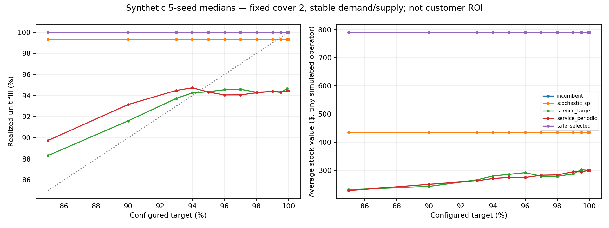

# Final causal synthetic results — not customer validation

4,005 main policy runs, 300 ablation runs (including repeated controls).
89 main cells and five seeds per cell. Results below use only `evidence/causal/`;
the rejected earlier replay is excluded. [Method and limitations](BENCHMARK_METHOD.md)

**The fixes improve correctness; they do not establish a launchable autonomous
savings engine.** The safe selector mostly abstains and its two departures
lose. Neither service-target variant clears a commercialization test. A
favorable pooled median for an ungated model conceals substantial downside.

## Every policy, including failures

Each policy has 445 runs. Savings compare common operating loss with the
configured fill-aware incumbent, not all costs or sales. Pooled medians are
descriptive; the deliberately chosen grid is not a population of customers.

| Policy | Median saving | Full range | Cost losses | Fallback reviews | Target breaches |
|---|---:|---|---:|---:|---:|
| Incumbent | 0.00% | 0 to 0 | 0 | 0 | 46 |
| Order-up-to | −19.01% | −95.46 to +87.11% | 400 | 0 | 36 |
| Deterministic SP | −145.25% | −1129.48 to +78.53% | 378 | 0 | 235 |
| Legacy SP, pipeline hidden | −18.49% | −221.78 to +90.24% | 349 | 23 | 43 |
| Pipeline-aware SP | +5.23% | −523.55 to +89.76% | 192 | 2 | 116 |
| Anchored SP | +13.38% | −442.99 to +89.93% | 115 | 2 | 79 |
| Aggregate service-target | −262.51% | −1576.57 to +65.37% | 427 | 6 | 309 |
| Per-period service-target | −259.34% | −1447.85 to +65.36% | 426 | 13 | 300 |
| Hardened safe selector | 0.00% | **−2.10 to 0.00%** | **2** | 0 | 46 |

Huge negative percentages use a sometimes-small incumbent loss denominator.
Do not describe −262% as a fraction of throughput lost. Dollar components
and each cell's service, inventory and failed solves are available in the
[full rows](evidence/causal/runs.csv), [cell summaries](evidence/causal/cell_summary.csv)
and [readable every-cell table](evidence/causal/EVERY_CELL.md).

### The gate is conservative, not a guarantee or a savings result

Of 1,335 reviews, the selector retained the incumbent **1,333 times**. It
selected SP once and aggregate service-target once. There were no winning
complete runs; the two departures caused:

| Cell / seed | Conditions | Saving | Dollar loss | Service change |
|---|---|---:|---:|---:|
| 73 / 403 | Moderate disruption | −2.105% | $6.57 | −0.188 percentage points |
| 79 / 405 | Variable leads | −0.827% | $2.28 | +0.206 percentage points |

These are tiny synthetic operators, not prospective contract values. The
second loss improves service yet still loses on the agreed economic objective.
Historical acceptance does not ensure future superiority. No thresholds were
retuned to make these two runs disappear. Do not promote the new target-only
candidate to the default product; it was included explicitly to test the idea.

## Headline curve: configured target is not achieved service

At cover2 with stable demand/supply, the per-period candidate's median realized
fill is 89.74% at target85%, 93.15% at90%, 94.49% at93%, **94.06% at97%**, and
94.45% at100%. Its median stock value rises from $228 to $300. The incumbent
has median100% fill and $791 stock; the regular SP has median99.34% fill and
$435 stock. Seed ranges and failure counts must accompany those medians.

The requested 93/94/95/96/97/98/99/99.5/99.9 frontier points are all in
[service_curve.csv](evidence/service_curve.csv). The [marginal table](evidence/marginal_service.csv)
separates carry, shortage and inventory changes. Where realized service is flat
or falls, there is no defensible positive “dollars per extra service point”
to quote. Adding a harder in-sample constraint does not calibrate the out-of-sample
forecast, recover unknown pipeline, or fix finite-horizon execution effects.

The per-period variant fixes one mechanism—borrowing a future service allowance—
but the rerun shows it is **not sufficient**. The failed results remain as
evidence against deploying target-only right-sizing with this scenario/rolling
setup. Do not turn the visually lower stock curve into a savings pitch.

## Four operator tests

All examples below fix target97%; each is five seeds. These are mechanisms,
not actual operator archetypes inferred from revenue.

| Test | Result | Commercial interpretation |
|---|---|---|
| Low opening cover0 | SP median−116.09%, range−206.59 to+24.81%; incumbent median99.82% fill | Low opening stock did not create a genuinely low-service incumbent because it also has pipeline and an effective rule. Protection value is not demonstrated by this cell. |
| Excess cover6 | Anchored median+7.74%, range−78.81 to+11.49%; median100% fill, $1,491 stock vs incumbent$1,617 | Possible right-sizing benefit, not reliable dominance. Safe selector retains incumbent. |
| Balanced cover2 | Anchored median+29.15%, range−153.30 to+38.94%; no modeled target breaches | Strong median still has a damaging seed; insufficient deployment evidence. |
| Severe disruption/recovery episode | SP median+16.36%, range+0.001 to+30.16%; median fill84.50% vs incumbent84.23%; every seed misses97% | Lower economic loss does not make service feasible. Extra inventory cannot manufacture unavailable capacity. |

The architecture can choose not to change a good policy. It does not yet
demonstrate the stronger property of reliably improving all four operator
types. Remaining with the incumbent satisfies a safety posture but supplies
no incremental optimizer revenue case.

## Ablations: paired attribution, not subtraction of unrelated medians

On the five-cell ablation set (25 paired seed/cell cases), positive dollars
below mean the addition reduced common cost. These small dollar scales are
intentional mechanism units, not customer estimates.

| Change | Median paired dollars saved | Range | Improving cases |
|---|---:|---|---:|
| SP → anchored SP package | +$0.97 | −$130.48 to+$50.62 | 13/25 |
| Anchored without CVaR → with CVaR | **−$1.41** | −$106.68 to+$6.90 | 12/25 |
| SP → adaptive state package | **−$7.12** | −$156.94 to+$154.77 | 12/25 |
| Open-loop SP → rolling SP | +$16.60 | −$96.00 to+$403.38 | 18/25 |
| Aggregate target → per-period target | +$3.94 | −$23.92 to+$32.62 | 14/25 |

Across the main grid, restoring planner pipeline saves a median **$4.11 paired**
against the pipeline-hidden SP, range−$291.87 to+$45.74, improves284/445 cases.
That is not the difference of the two pooled medians. Feasibility/fallback
changes are part of this paired effect; it is not exclusively inventory cost.

Repeated controls in the main and ablation outputs match with **zero maximum
cost difference** on the same seed/cell/policy. [Ablation every-cell results](evidence/causal/ablations/EVERY_CELL.md)
show full ranges. The gate retains the incumbent throughout these five ablation
cells; its cost losses occur elsewhere in the larger grid.

No isolated value is claimed for copulas, independent route signals, DRO,
segmentation, transfers or alternate-source economics. These are not silently
included in an “adaptive” benefit number. The next research priority is measured
scenario/pipeline calibration and causal long-run same-service comparison—not
another complexity layer or more favorable seed selection.
