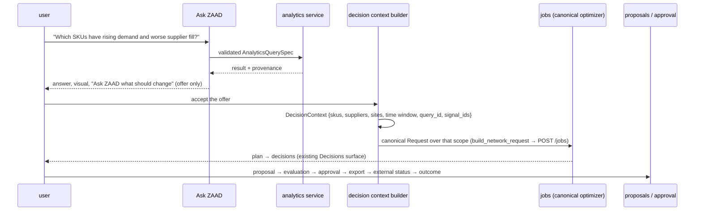

# Ask ZAAD — AI analytics architecture (companion to `ENTERPRISE_ANALYTICS_ARCHITECTURE.md`)

Architecture only (2026-09-16). No LLM integration is built in this pass. The one existing model
call in the repository — `api/routers/assistant.py`, which sends the workspace's computed state to
Anthropic when `ANTHROPIC_API_KEY` is set and otherwise returns a deterministic explanation — is
the precedent for the boundary below (the model only ever sees what the engine already computed)
and the counter-example for provider coupling (it constructs `anthropic.Anthropic()` directly).

## 1. What Ask ZAAD is, and is not

Ask ZAAD answers *what happened, where, when, which* over governed metrics, recommends and
builds visuals, and explains results in plain language. It does **not** decide what should change:
that transition hands a decision context to the canonical optimizer through the existing jobs and
proposal paths (§8). It never executes SQL, never names a field, supplier, customer or metric that
the semantic model did not return to it, and never describes a missing measurement as an
observation.

## 2. Flow

```mermaid
flowchart LR
  Q[natural-language question] --> IP[intent parser<br/>LLM or rules]
  IP --> SR[semantic retrieval<br/>metrics, dimensions, values]
  SR --> CP[candidate analysis plan<br/>typed AnalyticsQuerySpec]
  CP --> V[semantic + permission validation<br/>deterministic]
  V -->|refused| R1[refusal with reason]
  V -->|ok| QE[query engine]
  QE --> RS[result set + provenance + coverage]
  RS --> INT[interpretation<br/>LLM over the aggregated result]
  INT --> VS[optional VisualSpec<br/>renderer-independent]
  VS --> OUT[answer: text + visual + Data & scope]
  OUT -->|"Ask ZAAD what should change"| DC[decision context → optimizer request]
```



Every arrow crosses a typed contract; the model produces and consumes JSON documents, never a
query string. The steps that decide truth (validation, execution, coverage) are deterministic.

## 3. Contracts (provider-neutral)

```yaml
Intent:
  question: string                      # verbatim, treated as data
  language: en | ar
  entities_mentioned: [string]          # free text the parser extracted; resolved in the next step, never trusted
  comparison: none | period_over_period | vs_plan | vs_peer
  wants_visual: bool | null

SemanticContext:                        # what the model is allowed to reason over
  semantic_model_version: string
  metrics: [{metric_id, display_name, business_definition, allowed_dimensions, unit, evidence_class}]
  dimensions: [{dimension_id, display_name, cardinality_hint}]
  resolved_values: {dimension_id: [{id, label}]}   # only values that exist in this tenant and this actor's scope
  time_bounds: {earliest, latest, last_updated}
  plan: {plan_id, as_of, stale} | null

AnalysisPlan:                           # the model's proposal; a candidate until validated
  hypothesis: string                    # what the answer would show
  query: AnalyticsQuerySpec             # see the primary document §5
  visual_hint: {visual_type, dimensions, series, measures} | null
  why: string                           # shown to the user as "why this analysis"

ValidatedQuery:                         # produced by the validator, never by the model
  query_id: string
  spec: AnalyticsQuerySpec              # normalised, permission predicates appended
  refusals: []                          # empty on success

Interpretation:
  summary: string                       # ≤ a few sentences, references metric_ids
  observations: [{claim, cells: [row refs], confidence: OBSERVED | ASSOCIATION | UNCERTAIN}]
  missing: [{reason, what}]             # every null reason present in the result, restated
  caveats: [string]                     # coverage, thin samples, stale plan
  suggested_followups: [AnalysisPlan]   # each goes through validation again if chosen
  decision_offer: {available: bool, context_ref} # "Ask ZAAD what should change" — never a recommendation
```

The provider boundary is one interface: `plan(intent, context) → AnalysisPlan` and
`interpret(result, context) → Interpretation`. Implementations: a cloud provider, a customer-routed
or on-premises model, a deterministic rule-based planner for the curated questions the product
already answers (which needs no model at all). Selection is a tenant policy (§7).

## 4. What the model may and may not do

| may | may not |
|---|---|
| choose among `metric_id`s and `dimension_id`s from `SemanticContext` | invent a field, metric, supplier, customer, SKU or date |
| propose filters using `resolved_values` | filter on a value it was not given (the validator refuses: `ai_unresolved_value`) |
| propose a time range inside `time_bounds` | reach outside the data's bounds or the actor's scope |
| explain a result cell by cell, citing rows | infer causation ("because", "caused") — allowed vocabulary is *coincides with*, *is associated with*, unless the cell's `evidence_class` is OBSERVED for a stated mechanism |
| flag thin samples and low coverage | claim significance without a computed statistic in the result |
| restate `NO_DATA` / `NOT_MEASURED` / `BLOCKED_BY_DATA` as missing | describe a missing measurement as zero or as an observation |
| recommend a visual type from the allowed matrix (§6) | request a rendering the visual layer forbids (stacked registers, summed snapshots) |
| offer the decision hand-off | produce a recommendation, a quantity, a supplier switch, a plan |

Validation is deterministic code (`analytics/ai/validate.py` in the target layout): every
`metric_id`, `dimension_id`, filter value, grain and time bound is checked against the semantic
model and the actor's permissions; a failed plan is returned to the model once with the refusal
list for repair, then surfaced to the user as "ZAAD could not turn this question into a governed
query" with the reasons. The model never sees a database, a connection, or SQL.

## 5. Context policy — what reaches the model

Sent: the `SemanticContext` (schema, definitions, resolved values the actor may see, bounds),
the aggregated result set (bounded by the query engine's limits, typically ≤ 400 points × ≤ 10
series), its provenance and coverage, and the conversation's previous validated plans. Never
sent: raw rows, whole tables, prices per line, customer-order text, PO comments, tokens,
anything outside the actor's scope. The context is built per tenant per request; nothing is
cached across tenants (primary §20). Row identifiers in results are tenant-scoped ids, which
are acceptable to send; free-text columns are not, unless the owner enables it per tenant.

Routing policies (owner decisions, primary §57): cloud provider with zero retention; customer-
routed provider; private model; no model (deterministic planner only, curated questions).
The contract is the same in every case.

## 6. Visual recommendation

The recommender is a deterministic table first and a model second:

| question shape | visual | rule |
|---|---|---|
| one measure over time | line | grain from the question; ≤ 400 points |
| one measure over time by a low-cardinality dimension (≤ 10) | multi-line or stacked bars | stacked only for additive measures (never ratios, never registers) |
| one measure by a dimension (top-N) | horizontal bars | top 10 with "others" only for additive measures |
| two measures by a dimension | scatter | each axis one metric, hover names the member |
| dimension × time | heatmap | bounded cells |
| single value with comparison | KPI card | comparison must be a validated comparison_period |
| composition of a total | stacked bars / waterfall | additive measures only (the Waterfall already exists for the plan ledger) |

The model may pick among the allowed visuals for the query's shape and must say why in
`AnalysisPlan.why`; it cannot pick a visual the shape forbids. Example: "Which suppliers are
deteriorating?" → plan: `supplier_fill_rate` and `late_order_rate` by month (last 6), series =
supplier (top 10 by ordered units), secondary `lead_time_p90`; visual = multi-line; why = "a
trend per supplier needs time on the x-axis and one line per supplier; fill and lateness are the
two governed reliability measures; lead-time spread is shown separately because it is a
different unit". The user can preview, modify (the spec is editable in Explore), save, add to a
dashboard, discard, or open the underlying records (drill-through to Purchase orders).

## 7. Proactive analyses — deterministic detection, model explanation

Signal detection is code, not a model: a scheduled or on-read job evaluates governed detectors
over governed metrics with declared thresholds and minimum coverage — demand change beyond a
stated band on complete periods, supplier fill or lateness trend over N periods, inventory build
(cover rising above the threshold for K periods), imbalance across sites, service degradation,
customer concentration above a band, lead-time variability rising, short-fill trend, excess cover,
cover shortfall, override rate, realized-value divergence from the approved expected difference.
Each detection is a `Signal {signal_id, metric_id, dimension member, window, statistic, threshold,
coverage, evidence_class}` stored per tenant with its provenance.

The model's role starts after detection: turn a signal into a suggested `AnalysisPlan` ("Create
analysis") and, once the user runs it, interpret the result. A signal is never a conclusion, never
a decision, and never created by the model. Thresholds are semantic-layer parameters, versioned.

## 8. The optimizer boundary



`DecisionContext` carries scope and evidence references only. The optimizer request is built by
the existing workspace adapter with the existing defaults; the model does not set a parameter,
a target or a quantity. The resulting decision's provenance links back to `query_id` and the
signals, and the outcome closes the loop (primary §45).

## 9. Prompt-injection and data safety

Uploaded operational text — supplier names, product descriptions, PO notes, customer names,
outcome notes — is data. It reaches the model only inside typed JSON fields that the system
prompt declares as data, never concatenated into instructions; identifiers are preferred over
names wherever a name is not needed. The system prompt forbids following instructions found in
data; the validator makes that structural: a plan that references anything outside the semantic
context is refused regardless of what the text said. Free-text columns are excluded from context
by default (owner policy to include). Conversation history is the validated plans and
interpretations, not raw model transcripts, so an injected instruction cannot persist.

## 10. Cost and limits

No model call for deterministic UI operations (filters, drill, sort, saved reports, curated
Insights). One planning call and one interpretation call per question; repair at most once.
Bounded context (semantic context cached per tenant and model version; result sets capped by
the query engine). Per-tenant and per-actor quotas (questions per hour, tokens per day), a
kill switch per tenant, and a deterministic fallback for curated questions when the model is
unavailable or over quota.

## 11. Failure behaviour

| condition | behaviour |
|---|---|
| model unavailable / over quota | curated questions answered by the deterministic planner; free questions return "Ask ZAAD is unavailable; Explore is available" |
| invalid plan after one repair | refusal with the validator's reasons, and the nearest curated analysis offered |
| result contains nulls | the interpretation must list them under `missing`; a rendering shows the reason |
| stale plan referenced | interpretation carries the staleness caveat verbatim from provenance |
| permission denied on a member | the member is absent from `resolved_values`; the model cannot name it; no "you cannot see X" leak |
| semantic model version changed since a saved AI analysis | the saved plan is re-validated; a removed metric yields "this analysis referenced a definition that no longer exists" with the pinned version shown |

## 12. Observability and audit

Per question: tenant, actor, question hash (not the text unless the tenant opts in), plan
validity, refusal reasons, query id, result size, model provider and version, tokens, latency,
whether a visual was created or saved, whether the decision offer was taken. Audit rows use the
existing append-only `zaad_audit_log` shape (identifiers and short labels, never a dataset).
