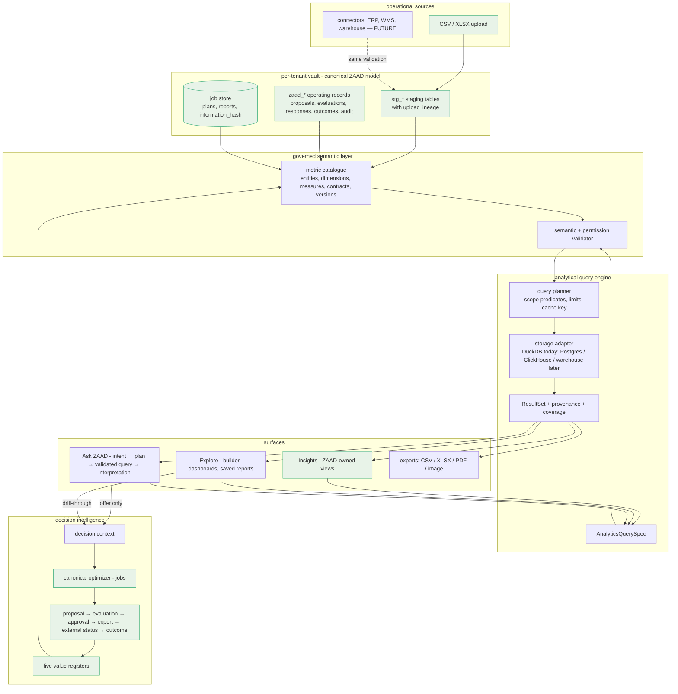
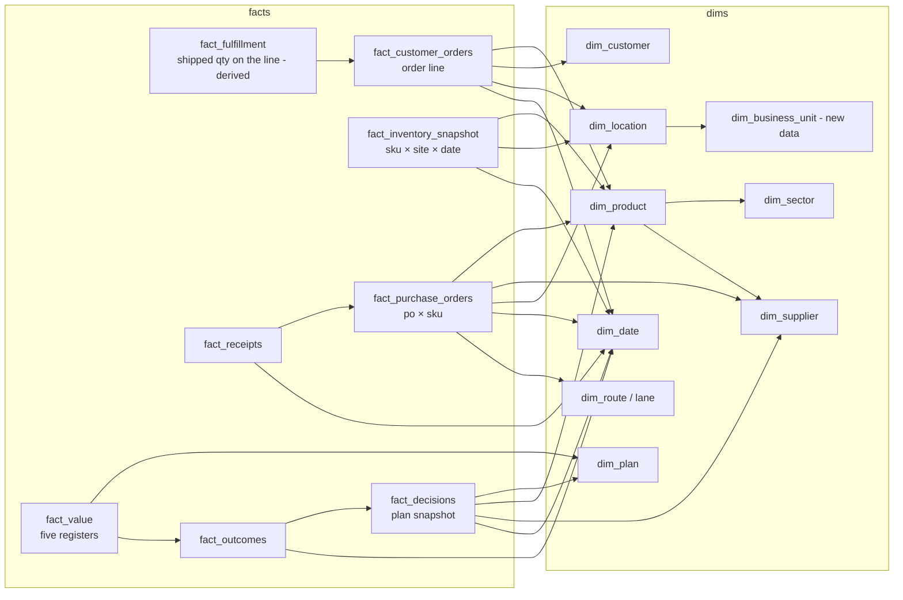
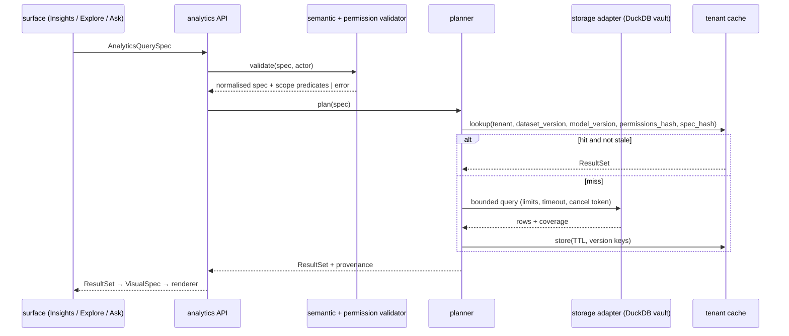
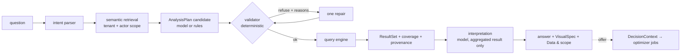
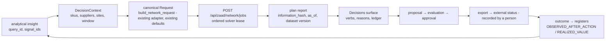
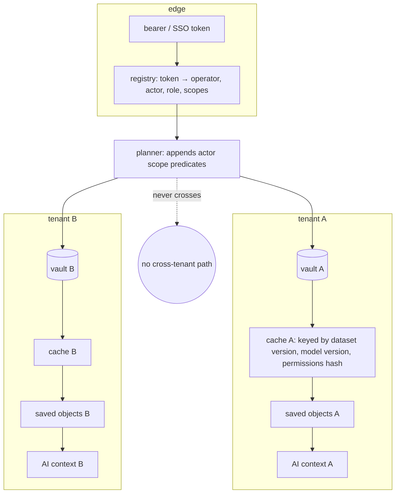

# ZAAD enterprise analytics and AI exploration — architecture

**Status: architecture only (2026-09-16).** Nothing in this document is implemented. It is the
blueprint for three surfaces — **Insights** (ZAAD-owned views, the released V2.1A section),
**Explore** (self-service analysis over governed data) and **Ask ZAAD** (AI-assisted analytical
exploration) — on one canonical model, one governed metric layer and one provenance system,
inside the decision loop ZAAD already runs. Companions: [`SEMANTIC_LAYER_ARCHITECTURE.md`](SEMANTIC_LAYER_ARCHITECTURE.md)
(entities, dimensions, the classified metric catalogue, the metric contract) and
[`ASK_ZAAD_AI_ANALYTICS_ARCHITECTURE.md`](ASK_ZAAD_AI_ANALYTICS_ARCHITECTURE.md) (the AI flow,
contracts, safety and the optimizer boundary). Security and the data model are in this document.

Written against `main` `07c230f` (production runtime `914c5c3`, Fly v29, the full performance
pass). Where this document says "today", it describes code read on that commit, not filenames.

## 0. Current state, read from the code

| layer | what exists today | where |
|---|---|---|
| tenant model | one operator = one workspace = one DuckDB vault file (`data/operators/<id>/…`), resolved from a bearer token by a JSON registry (`registry/operators.json`); `get_conn` yields the caller's own vault, `get_read_only_connection` its read-only twin; a cross-vault connection exists only for an explicitly named list of operators with a stated purpose | `api/dependencies.py`, `infrastructure/operator_registry.py`, `infrastructure/db_manager.py` |
| people and roles | an actor is a token in a workspace with a role `VIEWER / BUYER / APPROVER / ADMIN`; 14 capabilities (`view manageData createProposal editDraft evaluate review approve export recordExternal recordOutcome respondDecision manageProfiles manageSettings manageActors`); every write endpoint checks one | `api/product/governance.py`, `api/routers/zaad_history.py` |
| audit | one append-only table `zaad_audit_log` (actor, role, object type / id, action, before / after state, request id, short context); telemetry is an allowlist of event names and identifier keys (`zaad_telemetry`) | `governance.record_audit`, `zaad_history.telemetry` |
| canonical data | uploaded staging tables per vault with per-row lineage stamps (`_upload_session_id`, `_uploaded_at`, `_source_file`, `_operator_id`): `stg_fmcg_skus / orders / purchase_orders / receipts / inventory / promotions / suppliers / locations / lanes / transfers / sources`, `stg_atp_*`, `stg_po_commitments / options`, sector columns; the planning contract `Request` (67 fields) built from them by the workspace adapter | `db/migrations/013–027`, `zaad/full/workspace.py`, `zaad/full/contracts.py` |
| operating-product records | proposals (`zaad_draft_orders / lines / events`), evaluations (two job ids, `workspace_version`, `draft_hash`), export profiles and log, decision responses, outcomes (metric, value, observed_at, comparator and its basis), settings, idempotency | `api/product/drafts.py`, `evaluation.py`, `exporting.py`, migrations 023–027 |
| jobs | a SQLite job store with purposes `WORKSPACE_PLAN / PROPOSAL_BASELINE / PROPOSAL_OVERLAY / DIAGNOSTIC_REPLAY / SYSTEM_TEST`, `request_json`, `report_json`, `information_hash`, `as_of`, one ordered solver lease | `zaad/full/jobs.py`, `api/routers/zaad_full.py` |
| Insights backend | bounded server-side aggregations over the vault with one `Scope` of filters, provenance on every payload (source tables, metric, numerator, denominator, filters, coverage, last updated, plan identity and staleness), nulls with reasons, five value registers never combined, the latest DONE plan read verbatim from the job store; `MAX_POINTS = 400`, `TOP = 10` | `api/product/insights.py` (902 lines), `api/routers/zaad_insights.py` (11 routes) |
| Insights frontend | URL-held filters, typed fetchers, `shown()` for honest nulls, `ChartCard` (figure + description, *Show as table*, *Data & scope* disclosure), Recharts wrappers (`LineSeries`, `MultiLine`, `StackedBars`, `GroupedBars`, `HBars`, `Waterfall`), six tabs + Perishability, a period drill-down drawer, links to Inventory / Purchase orders / Data / Decisions / Diagnostics | `web/src/lib/zaad/insights.ts`, `web/src/app/insights/page.tsx`, `web/src/components/insights/ChartCard.tsx`, `web/src/components/charts.tsx` |
| other reads | bounded, paginated, server-side catalogue reads (Inventory, Purchase orders, SKU / PO detail, readiness, search, Data explorer over declared datasets and columns), supplier and sector diagnostics with the OBSERVED FACT / ASSOCIATION discipline | `api/product/catalog.py`, `readiness.py`, `diagnostics.py`, `api/routers/zaad_workspace.py` |
| export | approved proposals as CSV / XLSX / PDF through a workspace-defined mapping profile; "exporting is not transmitting" | `api/product/exporting.py`, `outbound.py` |
| optimizer integration | `GET /request/from-workspace` builds the canonical `Request` (scoped by `skus=`); `POST /jobs` runs it under the lease; Decisions, evaluation and Insights read the stored report | `api/routers/zaad_full.py`, `zaad/meio/workspace.py` |
| AI | one assistant endpoint that sends the workspace's computed state to a cloud model when a key is set, else a deterministic explanation; provider constructed directly | `api/routers/assistant.py` |
| web ↔ API boundary | the browser calls a typed client (`apiFetch`) with a session-stored bearer token; no SQL, no direct database; the planning read is 1.2–3.6 MB of JSON (gzip since the performance pass) | `web/src/lib/api.ts` |
| scale, measured | every operating read ≤ 60 ms at 10 k and ≤ 310 ms at 50 k products (2.6 M order rows) in process; Insights ≤ 437 ms at 50 k; the planner's workspace read 3.6 s / 14 s scoped to 200 products at 10 k / 50 k | `ZAAD_FULL_PERFORMANCE_PASS.md` §2, `FABLE_V2_1_RELEASE_AUDIT.md` §4 |

What does not exist today: a machine-readable metric catalogue (definitions are prose in
`provenance(...)` calls and formulas in three modules), a typed analytical query contract (each
Insights route is a hand-written aggregation), saved analyses or dashboards, sharing, row-level
scopes below the workspace, dataset versions as objects (only per-row stamps), business units,
a visual specification independent of Recharts, an AI planner over metrics, proactive signals.

## 1. Architectural principle

```
OPERATIONAL DATA → CANONICAL ZAAD MODEL → GOVERNED SEMANTIC LAYER → ANALYTICAL QUERY ENGINE
→ VISUAL / AI EXPLORATION → DECISION INTELLIGENCE → OPTIMIZER → ACTION → OUTCOME → REALIZED VALUE
```

ZAAD is not "Power BI with an optimizer attached". The analytics system reads the same vault rows
and the same stored plan the optimizer and the operating surfaces read; a KPI has one governed
definition (the semantic layer) used by every dashboard, every Ask ZAAD answer, every export and
the optimizer's own workspace adapter where the two overlap (weeks of cover, fill, lateness).
One canonical model, one metric layer, one provenance system.

### A. Full system architecture



Green = exists today.

## 2. The three surfaces

| surface | who designs it | what it answers | what it must never do |
|---|---|---|---|
| **Insights** | ZAAD | the operational questions ZAAD believes matter: demand (observed customer orders), inventory, supply, suppliers, customers and service, decisions and value, perishability, network | start a solve; recompute a plan number; combine registers |
| **Explore** | the user, from governed parts | any composition of governed metrics × allowed dimensions × time grain, as tables, pivots and charts; saved analyses and dashboards | define a metric; send SQL; load a dataset into the browser |
| **Ask ZAAD** | the user in language, the system in contracts | "what / where / when / which", visual recommendations, explanations, follow-ups; the hand-off to "what should change" | invent a field, member or metric; execute a query; decide |

Insights becomes the first tenant of the semantic layer: each of its eleven aggregations is
re-expressed as a saved, ZAAD-owned `AnalyticsQuerySpec` + `VisualSpec` (§54), so a curated view
and a user-built one are the same kind of object with different ownership.

## 3. Governed semantic layer (summary; full catalogue in the companion)

Entities (Product, Supplier, Customer, Location, PO / PO line, Receipt, Inventory snapshot,
Customer order / line, Transfer, Lane, Plan, Decision, Response, Proposal, Evaluation, Approval,
External action, Outcome, Upload session; Business unit REQUIRES NEW DATA), dimensions (SKU,
category, brand, ABC, supplier, origin / corridor, customer, channel, service class, location,
destination, lane, date → week / month / quarter / year, states, verbs, registers, sector),
measures classified EXISTS / DERIVABLE / REQUIRES NEW DATA / FUTURE. The measures that exist
today number about 25 and come from three modules that each hold their own formula; the layer
moves each formula into one contract and turns the modules into consumers.

Every metric carries the contract of §4 of the companion: id, versions, localised names,
business definition, numerator, denominator, source entities, time semantics, aggregation rule,
allowed and disallowed dimensions, required fields, coverage definition with thresholds, null
behaviour per missing case, unit, currency behaviour, grain, owner, evidence class
(OBSERVED_FACT / ASSOCIATION / MODELED / PLAN_SNAPSHOT), security classification, implementation
fragment, lineage, compatibility. The layer prevents AI-defined, frontend-defined, dashboard-
hidden and duplicated definitions because a saved object can only reference `metric_id@version`.

### G. Semantic model relationships



Facts and dimensions are **logical semantic views** over the vault tables in the first two
phases (no duplication of truth); the only physical objects added are (a) a dataset-version
table (§8) and (b) evidence-driven preaggregates (§23), both rebuilt from the vault, never
edited. Both a star-schema view (for Explore's pivot mental model) and the domain graph (for
join validation and Ask ZAAD's retrieval) are exposed; they are two projections of one catalogue.

## 4. Metric contract

See the companion §5. The two rules that matter architecturally: the aggregation function is part
of the contract (a requester picks grain and dimensions, never `sum` vs `avg`), and a register is a
dimension that no query may sum across.

## 5. Query architecture

```
USER INTENT → AnalyticsQuerySpec → semantic validation → permission validation → query planner
→ storage adapter → ResultSet → provenance → VisualSpec → renderer
```

```yaml
AnalyticsQuerySpec:                       # the only thing a surface may send
  semantic_model_version: "2026.10"
  measures: [{metric_id, version?, alias?}]          # ≤ 6
  dimensions: [{dimension_id, level?}]               # ≤ 3 (pivot: rows + columns)
  time: {grain: day|week|month|quarter, range: {start, end} | {last: 12, unit: week}, anchor: metric default}
  filters: [{dimension_id, op: in|eq|between|contains_id, values: [...]}]
  comparison: null | {kind: period_over_period, lag: 1} | {kind: vs_plan, plan_id}
  sort: [{field, dir}]
  limit: 400                                         # points; server clamps to the tenant's cap
  top_n: {dimension_id, n: 10, others: false}        # others only for additive measures
  drilldown: {from_visual: id, member: {...}} | null
  purpose: insights | explore | ask | export | signal
ResultSet:
  query_id, semantic_model_version, dataset_version, generated_at
  columns: [{id, kind: dimension|measure|comparison, metric_id?, unit?, currency?}]
  rows: [[...]]                                      # cells are value | {reason, why}
  coverage: {per metric: {measured_share, thin_sample, insufficient}}
  provenance: {source_entities, filters, time, plan?, last_updated, definitions: [metric_id@version]}
  bounds: {truncated: bool, limit_applied, top_n_applied}
  timing: {planned_ms, executed_ms, cache: hit|miss|bypass}
Error taxonomy:
  semantic_unknown_metric | semantic_unknown_dimension | semantic_dimension_not_allowed
  | semantic_no_join_path | semantic_aggregation_forbidden | semantic_version_deprecated
  | permission_denied | scope_filtered (silent narrowing recorded in provenance)
  | limit_exceeded | query_timeout | query_cancelled | dataset_unavailable | engine_unavailable
```

The frontend never sends SQL; DuckDB is never exposed to the browser; the AI produces an
`AnalyticsQuerySpec` candidate that goes through the same validator as a human-built one (ADR-1).
Sync for bounded specs (the caps above, the existing 60 s HTTP budget); async (job-style, with a
`query_id` to poll, cancellable) for exports, large drill-throughs and signal sweeps.

### B. Analytical query flow



## 6. Query engine — honest evaluation

| scale | data | today (measured) | works? | what fails first |
|---|---|---|---|---|
| pilot | ≤ 150 products, ≤ 0.5 M rows | reads 10–60 ms; Insights ≤ 200 ms; one vault file per tenant, one API process, 2 vCPU shared | yes | nothing in reads; the machine's burst budget when a plan runs |
| mid-market | 10–50 k products, 1–10 M rows | reads ≤ 310 ms at 50 k / 2.6 M rows; Insights ≤ 437 ms; single process | yes for reads, one user at a time measured | concurrency: one process, one vault file, GIL + DuckDB threads; the workspace read's Python construction (14 s at 50 k scoped to 200) |
| enterprise | 100 k+ products, 100 M+ rows, multi-year, hundreds of users, many tenants | not measured | not as deployed | a file-per-tenant DuckDB on one machine: storage on a single volume, no read replicas, no isolation between tenants' CPU, cache per process |

Engine positions:

* **DuckDB (embedded, file per tenant)** — keep as the pilot / mid-market engine and as the
  permanent *local and private* engine (a tenant's data never leaves its vault; no shared
  database). Its columnar execution is the right shape for analytics; the limits are operational
  (one file, one host), not query-shape limits. 10 M rows: fine. 100 M rows: per-tenant queries
  still run, but the host, the volume and concurrency become the ceiling; needs separate analytic
  workers and bigger storage, not a different query language. 1 B rows: not this deployment shape.
* **DuckDB + Parquet** — the first scale step: cold history (closed periods) as versioned Parquet
  partitions per tenant, hot data in the vault; DuckDB reads both. Keeps privacy and the adapter.
* **Postgres** — the right home for *governance objects* (saved reports, dashboards, catalogue
  versions, signals, audit at multi-tenant scale) when the JSON registry and SQLite job store
  stop being enough; not an analytical engine for 100 M-row scans.
* **ClickHouse** — the candidate for a ZAAD-hosted multi-tenant analytical tier at 100 M–1 B rows
  with concurrent dashboards; row-level tenant policies, materialized views for preaggregates.
  Only when a customer's scale demands it, behind the adapter.
* **Customer warehouse (Snowflake / BigQuery / Databricks / Redshift) federation** — an adapter
  that runs the *same* semantic query plans against the customer's warehouse holding the canonical
  entities (loaded by an integration, §29). Enterprise customers with data residency requirements
  bring their own; ZAAD's semantic layer stays the definition. Owner decision (§57).

**Adapter boundary (ADR-4):** `StorageAdapter.execute(PhysicalPlan) → rows`, where the planner
emits an engine-neutral relational plan (entities, filters, group-bys, measures as expression
templates from the contract's fragments) and each adapter renders its dialect. Metric fragments
are written once in a dialect-neutral form with per-engine overrides only where needed
(`date_trunc`, quantiles). Nothing above the adapter names DuckDB. Nothing is migrated in this
pass; the boundary is where the first Explore endpoint is built.

## 7. Canonical analytics model

Both star-schema-like semantic model (Explore) and domain graph (validation, AI retrieval) — §3,
diagram G. Physical form: **logical views first**; a dataset-version object (§8); evidence-driven
preaggregates (§23). No duplicated truth: a fact view reads the staging table with the same
dedup rule the operating reads use today (latest `imported_at` per key), so Inventory, Insights
and Explore agree by construction.

## 8. Data freshness

Today: per-row `_uploaded_at` / `imported_at`; `insights._last_updated` = max stamp across
staging tables; a plan's `as_of`, `finished_at`, `information_hash` and `stale` (any table
written after the plan finished); evaluations carry `workspace_version` (a hash of the vault's
state). Target:

* **DatasetVersion** object per tenant: `{dataset_version_id, created_at, per-table max stamp
  and row count, upload sessions included, source files, integration run ids}`; written when an
  upload or integration lands; every `ResultSet`, visual, export and AI answer carries the id.
* **Data cutoff** = the latest business date represented (last order date, last snapshot date,
  last receipt date) — distinct from *last updated* (when it was loaded); both shown.
* **Plan ↔ data**: a plan pins the dataset version it read; `stale` becomes "plan dataset version
  < current dataset version" with the list of tables that moved.
* **Staleness behaviour**: a cached result whose dataset version is not current is never served
  as current (§22); a dashboard shows the version and cutoff in its header; a saved report opened
  later re-runs against the current version and says so, or pins a version on request (export,
  audit).

## 9. Provenance

Chart: metric definition (`metric_id@version`, business definition), source entities, filters,
time range and grain, coverage, aggregation rule, `generated_at`, dataset version, plan identity
where plan-sourced, and — for AI-built visuals — the validated plan and the interpretation's
claims. Decision: plan id, engine version, input dataset version and `information_hash`, decision
reason codes, the economic ledger (all already stored in the report). Outcome: the action, the
observed result, measurement window, comparator and its basis (already `zaad_outcomes`). The
"Data & scope" disclosure that exists on every Insights chart becomes the one provenance
component for every surface, reading the same `provenance` object.

## 10. Null / unknown semantics

Formalised in the companion §8: every cell is `value | {reason, why}` with reasons `0` (a count),
`UNKNOWN`, `NOT_MEASURED`, `NOT_APPLICABLE`, `NO_DATA`, `BLOCKED_BY_DATA`, `NOT_IN_PLAN`,
`INSUFFICIENT_COVERAGE`. The renderer contract (§12) receives typed cells: a null with a reason
breaks a line or leaves a bar out and is listed in the legend; a chart library's default
`null → 0` is never reachable because the adapter that feeds Recharts (or any library) maps
reasons to gaps explicitly, and the table alternative shows the reason word. Ask ZAAD must restate
every reason present in a result (companion §4).

## 11. Explore builder

Layout: left = the semantic model (entities, dimensions, measures with definitions and
classification badges); centre = the canvas (table, pivot or chart, with its "Data & scope");
right = visual / filter / formatting; top = Ask ZAAD. Workflow: choose metric → dimension →
visual → filters → drill → save → add to dashboard.

```yaml
VisualSpec (renderer-independent):          # §12
  visual_id, visual_type: table|pivot|kpi|bar|stacked_bar|line|multi_line|area|scatter|heatmap|waterfall|distribution|map*
  title: {en, ar}, description: {en, ar}     # description required (accessibility)
  query: AnalyticsQuerySpec                  # or query_ref to a saved spec
  encoding: {x, y, series, size, color}      # references to result columns
  formatting: {number_style, unit_display, thresholds?, colors?}
  drill_path: [{dimension_id, next_level}]   # what a click opens
  drill_through: {surface: inventory|orders|data|decisions|diagnostics, params_from: [...]}
  interactions: {cross_filter: emit|receive|both}
  provenance: from the ResultSet
  semantic_model_version, created_by, created_at, version
Dashboard:
  dashboard_id, name, folder_id, owner, visibility: private|team|workspace
  layout: [{visual_id, x, y, w, h}]          # grid; mobile order derived
  shared_filters: [filter definitions bound to visuals]
  bookmarks: [{name, filter_state}]
  version, semantic_model_version
SavedAnalysis:  {analysis_id, name, folder_id, visual: VisualSpec, notes, origin: user|ask_zaad|zaad_curated, version}
FilterState:    URL-serialisable (the V2.1A rule), scoped per dashboard; cross-filter events are
                {source_visual_id, dimension_id, member} applied to receivers whose query allows the dimension
```

Every saved object is validated server-side against the semantic model on save and on open
(never raw frontend JSON), versioned, tenant-scoped, and carries the model version it was built
against (§32). Map visuals exist only where the location dimension carries coordinates (today
the contract carries none: the Network page already says so).

## 12. Visualization spec

The `VisualSpec` above is the contract; Recharts is one renderer behind `render(VisualSpec,
ResultSet)`. A second renderer (server-side image / PDF for exports, or another library) reads the
same spec. The spec pins encodings to result columns, not to a library's series shape; the
existing `MultiLine` / `StackedBars` / `HBars` / `Waterfall` become renderer implementations of
`visual_type`s.

## 13–16. Ask ZAAD, AI visuals, proactive signals, the optimizer boundary

In the companion. The load-bearing rules: the model produces and consumes typed contracts only;
validation is deterministic; signal detection is deterministic; the model never sees a database,
raw rows or another tenant; the hand-off to "what should change" builds a `DecisionContext` and
calls the existing workspace adapter and jobs path — the model sets no parameter and produces no
recommendation (ADR-1, ADR-5, ADR-10).

### C. AI query flow



### E. Optimizer hand-off



## 17. Security

| concern | today | target |
|---|---|---|
| tenant isolation | one vault per operator; connection bound to the token's operator; no shared cache | unchanged as the foundation; every analytics object, cache entry, signal, AI context and export keyed by tenant (§20); cross-vault reads remain explicit-list + purpose only, never for analytics |
| row-level security | none below the workspace | actor scopes as dimension predicates (`business_unit`, `region`, `location`, `supplier group`) attached to the actor record, appended by the planner, recorded in provenance (`scope_filtered`); members outside scope are absent from dimension-value lists |
| column-level | none | metric and dimension `security_classification` (OPERATIONAL / ECONOMIC / GOVERNANCE / RESTRICTED) mapped to roles; a spec requesting a restricted metric fails validation |
| roles | four roles, fourteen capabilities | eight roles (§18) over the existing capability model plus analytics capabilities |
| ownership and sharing | proposals have creators / approvers; nothing shareable | saved objects have an owner, a visibility, optional team; sharing is a capability; no public links by default (§26) |
| AI permissions | assistant reads the workspace state of the token's operator | `aiQuery` capability; the semantic context is built under the actor's scope; tenant policy chooses provider or none |
| export permissions | `export` capability on proposals | `exportAnalytics` capability; export log extended to analytics exports with dataset version |
| admin | shared admin key (fail-closed) for token issuance; workspace ADMIN role | unchanged; semantic-definition administration is a ZAAD-side release act, not a tenant setting |
| service accounts / API tokens | operator token, actor tokens (hashed) | service-account actors with a role and expiry for integrations and embedding; rotation; scoped to read or write |
| sessions | bearer token in browser session storage | unchanged for pilots; SSO sessions when identity is external |
| SSO / SAML / OIDC / SCIM / customer-managed identity | none | an identity adapter in front of the registry: external subject → actor with role and scopes; SCIM for provisioning; the registry remains the authority for workspace membership. FUTURE, owner decision on priority |
| audit | append-only `zaad_audit_log` | analytics events added (§19) with the same rule: identifiers and short labels, never data |

### F. Tenant / security boundary



## 18. Roles

| role | view | explore | create reports | share | export | run optimizer | create proposals | approve | record external | view realized value | administer definitions | AI query |
|---|---|---|---|---|---|---|---|---|---|---|---|---|
| Workspace Admin | ✓ | ✓ | ✓ | ✓ | ✓ | ✓ | ✓ | ✓ | ✓ | ✓ | workspace parameters only | ✓ |
| Planner | ✓ | ✓ | ✓ | team | ✓ | ✓ | ✓ | — | ✓ | ✓ | — | ✓ |
| Buyer | ✓ | ✓ | ✓ | team | ✓ | ✓ | ✓ | — | ✓ | ✓ | — | ✓ |
| Supply Chain Manager | ✓ | ✓ | ✓ | workspace | ✓ | ✓ | ✓ | ✓ | ✓ | ✓ | — | ✓ |
| Analyst | ✓ | ✓ | ✓ | workspace | ✓ | — | — | — | — | ✓ | — | ✓ |
| Executive | ✓ | limited (curated + saved) | — | — | ✓ | — | — | ✓ (policy) | — | ✓ | — | ✓ |
| Viewer | ✓ | — | — | — | — | — | — | — | — | — | — | curated only |
| Auditor | ✓ | ✓ (read) | — | — | ✓ | — | — | — | — | ✓ + audit trail | — | — |

Mapping onto today's four roles: VIEWER → Viewer; BUYER → Buyer (+ Planner as a variant with the
same capabilities and a different default surface); APPROVER → Supply Chain Manager; ADMIN →
Workspace Admin; Analyst, Executive and Auditor are new roles over new capabilities
(`explore`, `saveReport`, `shareReport`, `exportAnalytics`, `aiQuery`, `viewAudit`). Metric
definitions are administered by ZAAD (release-versioned), not by a tenant role; workspace
parameters of definitions (thresholds) by Workspace Admin — owner decision whether tenants may
define metrics at all (§57).

## 19. Audit

Events: report opened / created / edited / shared / exported / deleted; dashboard the same; AI
question asked (question hash, validated plan id, refusal reasons), query generated (query id,
spec hash, scope applied, result size), visual created (by user or AI), signal surfaced /
dismissed / turned into an analysis, decision hand-off taken (query id → job id). Stored in
`zaad_audit_log` (append-only) with identifiers and short labels; never rows, prices or the
question text unless the tenant opts in. Retention and export of the audit trail per tenant.

## 20. Multitenancy

Cache keys: `(tenant_id, dataset_version_id, semantic_model_version, permissions_hash, spec_hash)`;
AI context keyed the same without the spec; saved objects, dashboards, exports, signals carry
`operator_id` and are read `WHERE operator_id = ?` (the V2 rule for every `zaad_*` table). No
process-global cache holds tenant data without the tenant key; the semantic catalogue (definitions,
no data) is the only global cache. Lifecycle: a new dataset version invalidates every result
entry of that tenant; a new model version invalidates every tenant's entries for changed metrics;
a permissions change invalidates the actor's hash; TTL as a backstop. Storage today is one host;
the boundary holds whether entries live in process memory, a per-tenant DuckDB cache table, or a
shared store with the tenant key in every row.

## 21. Performance

Server-side aggregation and pagination for everything (the V2 / V2.1A rule, measured ≤ 310 ms at
50 k products for operating reads); result caps (points ≤ 400, series ≤ 10, table pages ≤ 200,
pivot cells ≤ 10 k); bounded drill-downs (one level, one member, capped); downsampling for
visuals at the grain level (day → week when the range exceeds the point cap, stated in
provenance); cancellation tokens and timeouts (interactive 20 s, export 5 min, signal sweep
bounded per tenant); per-tenant and per-actor query quotas; cache (§22) and preaggregates (§23)
only where measured. Targets: 10 k / 50 k / 100 k+ products, millions to 100 M rows, hundreds of
users per tenant, concurrent dashboards, AI bursts, large exports — architectural targets; the
measured figures are the 50 k / 2.6 M-row runs in the release records, single-user, in process.

## 22. Caching

Layers: semantic metadata cache (global, versioned, no data); dimension-value cache (per tenant
and actor scope, per dataset version); query-result cache (§20 key); dashboard-result cache (the
set of its queries, same keys); preaggregates (§23); AI query-plan cache (per tenant, model
version and question hash — plans only, never results). Every entry carries its version keys and
a TTL; a lookup with a stale dataset version is a miss, so no stale result masquerades as
current; the `ResultSet.timing.cache` field says hit or miss and provenance carries the dataset
version the result reflects.

## 23. Preaggregation

Evidence-driven: measured candidates from Insights' own aggregations — weekly and monthly
`ordered_units / shipped_units / unfulfilled_units` by SKU, customer and site; weekly
`inventory_units / value` by SKU and site (latest snapshot per bucket); monthly supplier fill,
lateness and lead-time quantiles by supplier; daily open-PO position by supplier and destination.
Not a cube of every combination: each preaggregate is a materialized view rebuilt per dataset
version from the vault, validated against the direct query on rebuild (identity check), used
only when the planner can prove the spec is covered (same grain or coarser, same filters as
dimensions). Today none is needed below ~10 M rows (measured); the first one is built when a
tenant's measured p95 crosses the interactive budget.

## 24. Lineage

`SOURCE FILE / ERP / API → INGESTION (upload session, integration run) → CANONICAL ENTITY (staging
row with stamps) → ANALYTICAL VIEW (fact / dim) → METRIC (contract fragment) → QUERY (query_id,
spec) → CHART (visual_id) → AI ANSWER (plan id, interpretation) → DECISION (job id, decision id)
→ ACTION (draft id, export id, external status) → OUTCOME (outcome id) → REALIZED VALUE (register
row)`. Every object carries the id of its predecessor; the "Data & scope" disclosure walks it
backwards, the decision detail forwards.

### D. Data lineage

```mermaid
flowchart LR
  F[source file / ERP / API] --> U[upload session<br/>_upload_session_id, _source_file]
  U --> E[canonical entity row<br/>_uploaded_at, _operator_id]
  E --> DV[dataset version]
  DV --> AV[analytical view - fact / dim]
  AV --> M[metric_id@version]
  M --> Q[query_id - spec, scope, coverage]
  Q --> CH[visual_id]
  Q --> AN[AI answer - plan, interpretation]
  CH --> DC[decision - job_id, information_hash]
  AN --> DC
  DC --> AC[action - draft_id, export, external status]
  AC --> OC[outcome_id]
  OC --> RV[register: OBSERVED_AFTER_ACTION / REALIZED_VALUE]
```

## 25. Saved reports

Objects: analysis, visual, dashboard, folder, bookmark, filter preset, AI-created analysis
(origin `ask_zaad`, with its validated plan), scheduled report (LATER). All validated on save
against the semantic model (unknown metric → refused; deprecated version → warning stored),
versioned (immutable revisions, `supersedes`), tenant-scoped, owned, with `semantic_model_version`
and the dataset version at save time. Storage: `zaad_analytics_*` tables in the vault in the
first phases (same isolation as `zaad_draft_*`); a governance database (§6, Postgres) when
multi-tenant scale requires it — behind the same repository interface.

## 26. Sharing

Private (owner), team (a named group of actors — new object), workspace (every actor with `view`).
Read-only links are off by default; if ever enabled they are tokenised, expiring, tenant-bound,
scope-bound and audited — an owner decision (§57). No public unauthenticated links.

## 27. Export

CSV / XLSX (tables and pivots), PDF / image (visuals and dashboards, server-rendered from the
`VisualSpec`), presentation-ready report (a dashboard at a pinned dataset version). Every export
embeds filters, time range, grain, generated timestamp, dataset version and data cutoff, metric
definitions (id, version, business definition), coverage and the provenance block; the existing
`safe_cell` rule (no formula injection) and the export log extend to analytics exports. Large
exports run async with a size cap and a quota.

## 28. Embedding — FUTURE

Signed, expiring, tenant- and scope-bound embed tokens for a saved dashboard rendered by the
same renderer; no product internals exposed. Not designed further here.

## 29. Integrations — FUTURE

Adapters (CSV / XLSX today; SFTP, REST, SAP, Oracle, Dynamics, NetSuite, Odoo, WMS, TMS, Snowflake,
Databricks, BigQuery, customer databases later) all land the **same staging tables through the
same validation** — the seam `api/product/inbound.py` already names (`InboundConnector`,
`SyncResult`). A connector maps to canonical entities; it never defines a metric. Each run creates
a dataset version with the run id as provenance.

## 30. Real-time vs batch

| analysis | cadence | why |
|---|---|---|
| Insights, Explore, Ask ZAAD over uploaded records | on read, over the current dataset version | data changes only when a file or integration lands |
| dataset version, freshness markers | at upload / integration completion | event-driven, cheap |
| proactive signals | at each dataset version, plus a daily sweep | detection over complete periods; streaming buys nothing for weekly supply-chain measures |
| plan-derived views | when a plan completes | already event-driven through the job store |
| integrations | hourly to daily pulls; near-real-time only for open-PO status if a customer's ERP supports it | most sources are batch exports |
| exports, scheduled reports | on demand / scheduled | async jobs |

No streaming dashboards: the trade-off is complexity and cost against measures that move
weekly; the honest freshness header (§8) is what an operator needs instead.

## 31. Data quality

Today: readiness and quality checks (`api/product/readiness.py`: coverage per field, quality
checks, upload family) and coverage counts per chart. Target: a `DataQualityFinding` object per
dataset version — missing promised dates, missing receipt quantities, duplicate PO lines, unknown
supplier or location on rows, stale inventory snapshot, incomplete customer-order history, rows
without cost — with counts and shares, feeding the metric contracts' coverage (a chart says
"41 % of open orders carry no promised date"), the Readiness surface, and Ask ZAAD's `missing`
list. Quality warnings, never false precision.

## 32. Semantic model versioning

`semantic_model_version` (a release of the catalogue) and per-metric `version`; saved objects pin
both; a deprecated version stays resolvable for a stated window; report migration is an explicit
user action ("update this analysis to the current definition") that records the change; an old
report never silently changes; exports and AI answers state the versions used. Historical
reproducibility = the pinned definition + the pinned dataset version (retained per tenant policy).

## 33. AI model independence

One provider-neutral boundary (`plan`, `interpret`) with typed contracts (companion §3); providers
are adapters selected by tenant policy; no chat-message shape crosses the boundary. The existing
assistant is refactored onto the same boundary (§54).

## 34. AI context

Schema, definitions, resolved values within scope, bounded aggregated results, coverage, freshness,
prior validated plans — never whole datasets, never free text by default (companion §5). Future
routing: local / private models, enterprise routing, zero-retention providers, customer policy.

## 35. Prompt injection / data safety

Data and instructions are separated structurally (typed JSON fields declared as data; identifiers
preferred to names; free-text columns excluded by default; the validator makes any instruction
in data inert because it cannot widen the semantic context). Companion §9.

## 36. Observability

Per query: tenant, actor role, spec hash, planned / executed ms, cache state, result size, rows
scanned, timeout / cancel, error class. Per surface: chart render failures (client telemetry
event), dashboard load time. Per AI call: plan validity, refusal classes, tokens, latency,
provider. Per tenant: query volume, expensive queries, export volume, dataset version age
(freshness), semantic-model errors, optimizer hand-offs. Existing `zaad_telemetry` allowlist
extended with the event names; no raw records logged.

## 37. Cost control

Bounded AI context and one repair; query caps, cancellation and quotas per tenant and actor;
result-size caps; cached semantic context; aggregated summaries to the model; no model call for
deterministic operations; rate limits (the existing per-IP-and-path limiter extended per actor);
enterprise quotas as tenant settings; an AI kill switch per tenant.

## 38. Failure modes — honest degradation

| condition | behaviour |
|---|---|
| query timeout | `query_timeout` with the plan's cost estimate and a narrower suggestion; nothing partial shown as complete |
| missing data | the reason word on the cell / chart, in the answer, in the export |
| partial dataset (an upload in progress) | the dataset version is not advanced until the session completes; reads see the previous version |
| stale data | freshness header on every surface; stale plan marked as today |
| AI unavailable | curated questions by the deterministic planner; free questions refused with "Explore is available" |
| AI produces an invalid query | one repair; then refusal with reasons; never executed |
| chart cannot represent the metric | the visual layer refuses the encoding (stacked registers, summed snapshots) and offers a table |
| permission denied | the object or member is absent; a direct request returns `permission_denied` without naming what exists |
| semantic model changed | saved objects re-validate on open; deprecated definitions shown pinned with a note; removed definitions refused with the pinned text |
| optimizer unavailable (lease busy, machine throttled) | the hand-off queues a job like any plan; analytics keeps reading the last completed plan (the V2.1A rule) |
| saved report references a removed field | opened in read-only "needs attention" state; never silently repaired |

## 39. Architectural separation (packages)

```
api/analytics/                      # new package beside api/product/
  semantic/     catalogue (entities, dimensions, metrics, contracts, versions), validator, join graph
  query/        AnalyticsQuerySpec, planner, scope predicates, limits, cancellation
  engines/      StorageAdapter protocol; duckdb adapter (first); parquet, clickhouse, warehouse later
  metrics/      metric fragments (dialect-neutral templates + per-engine overrides), coverage rules
  results/      ResultSet, cells with reasons, provenance assembly, downsampling
  visuals/      VisualSpec, encoding rules (what a visual may show), server-side render for exports
  saved/        analyses, dashboards, folders, bookmarks, teams, versions (vault tables first)
  cache/        tenant-keyed caches, invalidation on dataset / model / permission versions
  freshness/    DatasetVersion, cutoffs, plan ↔ data relationship
  quality/      DataQualityFinding per dataset version (builds on api/product/readiness.py)
  signals/      deterministic detectors, Signal objects, sweeps
  ai/           provider boundary (plan / interpret), context builder, validator, repair loop, policies
  exports/      analytics exports (extends api/product/exporting.py rules)
  permissions/  roles, capabilities, scopes, classifications (extends api/product/governance.py)
  lineage/      id chaining and the "Data & scope" walk
api/routers/zaad_analytics*.py      # the API families of §40
web/src/lib/analytics/              # semantic metadata, query state, visual state, dashboard, filters, cross-filter bus, AI conversation, saved state
web/src/components/analytics/       # renderers behind VisualSpec, builder panels, dashboard grid, Data & scope
```

`api/product/insights.py` is not moved; it is re-expressed (§54). Nothing under `zaad/` changes.

## 40. API families

```
GET  /api/zaad/analytics/model                      the semantic model this actor may see (entities, dimensions, metrics, versions)
GET  /api/zaad/analytics/dimensions/{id}/values     scoped, paged, searchable member lists
GET  /api/zaad/analytics/metrics/{id}               one contract, with versions and lineage
POST /api/zaad/analytics/query                      AnalyticsQuerySpec → ResultSet (sync within caps)
POST /api/zaad/analytics/query/async               → {query_id}; GET /query/{id}; DELETE cancels
GET  /api/zaad/analytics/freshness                  dataset version, cutoffs, plan relationship, quality summary
CRUD /api/zaad/analytics/analyses, /dashboards, /folders, /bookmarks, /teams, /visuals
POST /api/zaad/analytics/ai/query                   Intent → {plan, result, interpretation, visual?}  (sync, bounded)
POST /api/zaad/analytics/ai/recommend               Intent or query_id → visual recommendations with reasons
GET  /api/zaad/analytics/signals                    current signals; POST /signals/{id}/analysis creates the suggested analysis
POST /api/zaad/analytics/export                     spec or dashboard → async export job with provenance
POST /api/zaad/analytics/handoff                    query_id / signal ids → DecisionContext → existing jobs path
```

Contracts: request = the typed specs of §5 / §11 / companion §3; response = `ResultSet`,
`VisualSpec`, saved-object envelopes with versions; every response carries `provenance` and
`dataset_version`; errors use the taxonomy of §5 with `{code, message, details}` (the existing
`{detail: {code, message}}` shape); pagination by cursor for member lists and saved objects,
by page for tables; sync for bounded interactive queries, async for exports, sweeps, large drills.
All under `/api/zaad/analytics` beside the existing `/api/zaad/insights` (kept, §54).

## 41. Frontend architecture

Layers, separated: semantic metadata (fetched once per model version); query state (specs,
serialisable to the URL as V2.1A filters are); visual state (`VisualSpec`); dashboard layout;
filter state and a cross-filter event bus; AI conversation (validated plans and interpretations,
not transcripts); saved-object state. Visual components render a `(VisualSpec, ResultSet)` pair
and never fetch; one analytical service issues queries, deduplicates identical specs, cancels
superseded ones, and attaches provenance. The existing `WorkspaceDataProvider` stays the
operating layer; analytics has its own provider so that opening a dashboard never triggers the
planning read.

## 42. Mobile

Desktop: authoring (builder, dashboards). Tablet: exploration (filters, drill, saved analyses,
no layout editing). Mobile: consumption (curated Insights, saved dashboards in a single column
derived from the grid, KPI cards, "Data & scope"). Ask ZAAD on all three, with the visual
recommendation shown as a card on a phone.

## 43. Arabic / RTL

Metric ids canonical and language-independent; `display_name` and `description` localised in the
catalogue (en / ar); numbers and dates formatted by the existing product formatter with ISO digits
isolated `dir="ltr"` inside RTL text (the V2.1A rule); charts mirrored where reading order matters
(legend, axes) but time axes stay left-to-right; saved objects carry titles in both languages
where authored.

## 44. Accessibility

Every visual: a text summary generated from the `ResultSet` (the same sentence Ask ZAAD's
deterministic summariser would produce), a table alternative, keyboard access to every
interaction (the existing *Show as table*, period chips, drawers), a screen-reader description
(`aria-describedby`, already on `ChartCard`). No critical number lives only in a chart.

## 45. Optimizer integration — the closed loop

| from | to | how |
|---|---|---|
| supplier chart | supplier details | drill-through with the supplier id (today: `/diagnostics?tab=suppliers&q=`) |
| inventory chart | Inventory | filters carried (today: `linksFor.inventory`) |
| PO chart | Purchase orders | today: `linksFor.purchaseOrders` |
| service issue | Decisions | decision id from the plan snapshot (today: `?decision=`) |
| analytical anomaly / signal | optimizer context | `DecisionContext` → jobs (diagram E) |
| optimizer recommendation | analytical evidence | decision detail's *See demand / inventory / supplier / value* links (today: `InsightsLinks`), extended with the query ids that informed it |
| decision | outcome | `zaad_decision_responses` → `zaad_outcomes` (today) |
| outcome | realized value | registers (today: `insights.value`) |

## 46. Value registers

`MODELED_DIFFERENCE`, `BACKTESTED_OPPORTUNITY`, `APPROVED_EXPECTED_DIFFERENCE`,
`OBSERVED_AFTER_ACTION`, `REALIZED_VALUE` are five metric ids with `register` as a mandatory
dimension; the validator refuses a spec that sums or stacks across registers; the visual layer
refuses the encoding; Ask ZAAD's interpretation contract requires the register name in every
value claim and forbids the word "savings" for anything but `REALIZED_VALUE` with its comparator
basis stated. Language stays "observed after action", never "caused by ZAAD".

## 47. Documents

This document; `SEMANTIC_LAYER_ARCHITECTURE.md`; `ASK_ZAAD_AI_ANALYTICS_ARCHITECTURE.md`. Security,
governance and the data model are sections here rather than separate files.

## 49. ADRs

| ADR | decision | consequence |
|---|---|---|
| ADR-1 | The AI cannot execute arbitrary SQL; it emits an `AnalysisPlan` whose `AnalyticsQuerySpec` passes the same validator as a human-built one | no model touches a connection; refusals are deterministic and explainable |
| ADR-2 | Metrics live in the governed semantic layer, versioned in the repository; surfaces reference `metric_id@version` only | no frontend, dashboard or AI definitions; Insights' formulas migrate into contracts |
| ADR-3 | Visual specs are renderer-independent; Recharts is one renderer | exports, a second library and server rendering read the same spec |
| ADR-4 | The analytics engine is storage-adapter based; DuckDB per tenant is the first adapter and the permanent private engine | Parquet, ClickHouse or a customer warehouse can be added without touching definitions or surfaces |
| ADR-5 | The AI layer is provider-independent behind `plan` / `interpret` with typed contracts | cloud, private or no model per tenant policy |
| ADR-6 | Analytics and the optimizer share canonical entities: the same vault rows, the same stored plan, the same dedup rules | Inventory, Insights, Explore and the plan agree by construction; no second business model |
| ADR-7 | Every saved analytical object, cache entry, signal, export and AI context is tenant-scoped by key | no global cache holds tenant data; cross-tenant reads stay explicit-list + purpose, never for analytics |
| ADR-8 | Provenance is mandatory: every `ResultSet`, visual, export and AI answer carries definitions, scope, coverage, dataset version and plan identity | "Data & scope" everywhere; nothing renders without it |
| ADR-9 | Missing ≠ zero: cells carry reasons; renderers and the AI must show and state them | no chart library default reaches the screen; no answer describes a gap as a measurement |
| ADR-10 | The AI cannot generate optimizer decisions; it may build a `DecisionContext` that the existing adapter and jobs path turn into a plan | recommendations come only from the canonical optimizer under human approval |

## 50. Build phases (sequence chosen for dependency, not by the brief's numbering)

| phase | scope | depends on | proves |
|---|---|---|---|
| **A1 semantic foundation** | catalogue with the ~25 existing metrics as contracts (companion §4), join graph, validator, versions; Insights' three formula modules read fragments from it (no behaviour change; identity tests) | — | one definition per KPI; Insights unchanged bit for bit |
| **A2 typed query API + engine adapter** | `AnalyticsQuerySpec`, planner, DuckDB adapter, `ResultSet` with reasons, provenance, freshness (`DatasetVersion`), caps, cancellation, tenant cache keys; Insights routes re-expressed as saved specs (§54) | A1 | Explore-grade queries over governed metrics at the measured scale |
| **A3 Explore read-only builder** | model panel, canvas (table / pivot / chart), filters, drill, cross-filter, `VisualSpec` + Recharts renderer, "Data & scope", accessibility, RTL | A2 | self-service without persistence |
| **A4 saved analyses and visuals** | `zaad_analytics_*` tables, versions, validation on save / open, folders, bookmarks, export (CSV / XLSX with provenance) | A3 | reproducible saved work |
| **A5 dashboards** | layout, shared filters, cross-filter bus, presentation mode, PDF / image export, mobile consumption | A4 | curated + user dashboards on one object model; Insights tabs become ZAAD-owned dashboards |
| **A6 permissions and sharing** | roles (§18), capabilities, scopes as predicates, teams, sharing, audit events, service accounts | A4 | enterprise governance before AI and external identity |
| **A7 Ask ZAAD query generation** | provider boundary, context builder, intent → plan → validator → query → interpretation; deterministic planner for curated questions; existing assistant refactored onto the boundary | A2, A6 | governed natural-language analysis |
| **A8 AI visual recommendation** | recommender matrix + model choice with reasons; preview / modify / save / discard; AI-created analyses saved with their plan | A5, A7 | AI-built visuals under the same governance |
| **A9 proactive signals** | deterministic detectors, `Signal` objects, sweeps per dataset version, "Create analysis" | A2, A7 | detection without fabrication |
| **A10 analytics → optimizer hand-off** | `DecisionContext`, `/handoff`, decision provenance back-links, outcome closure in registers | A7, A9 | the closed loop |
| **A11 enterprise identity and scale** | SSO / OIDC / SAML, SCIM, customer-managed identity; Parquet cold history; governance database; ClickHouse or warehouse adapter where a customer's scale demands | A6 | enterprise deployment |

Sharing and permissions come before AI (A6 before A7) because AI context must be built under
scopes; dashboards before AI visuals; signals after the query API and the AI planner.

## 51. Do not overbuild

| feature | class | why |
|---|---|---|
| governed measures × dimensions × grains, pivot, tables, bar / stacked / line / area / scatter / heatmap / KPI / distribution | CORE | the analytical questions distributors ask, on governed definitions |
| drill-down, drill-through to operating surfaces, cross-filter, saved analyses, dashboards, export with provenance, Ask ZAAD, visual recommendation, signals → analysis | CORE | ZAAD's identity: from "what happened" to "what should change" and "what happened after" |
| top-N with others, comparison periods, bookmarks, presentation mode, scheduled reports | HIGH VALUE | common enterprise asks, cheap on the same objects |
| customer-defined calculated metrics (labelled `CUSTOMER_DEFINED`) | LATER, owner decision | governance risk; never blended unlabelled |
| maps | LATER (only when the contract carries coordinates) | the Network page already declines to place sites |
| forecast visuals | LATER (P6) | no calibrated forecast exists to draw |
| custom DAX-like language, arbitrary calculated columns | UNNECESSARY | breaks the one-definition rule; the optimizer's economics are the calculation layer |
| pixel-perfect and paginated reports | UNNECESSARY | exports with provenance cover the need |
| third-party visual marketplace, custom plugins, R / Python visuals | UNNECESSARY | governance and security surface with no decision value |
| real-time streaming dashboards | UNNECESSARY | measures move weekly; freshness headers are the honest alternative |
| geospatial layers | UNNECESSARY now | no coordinates in the canonical contract |

## 52. Competitive position

BI answers "what happened". ZAAD answers "what happened", "why" (associations with evidence
classes, never invented causation), "where is the exposure" (governed exposure metrics and
signals), "what should change" (the canonical optimizer under approval), "what happened after we
changed it" (outcomes) and "what value was realized" (registers, never collapsed). Every Explore
and Ask ZAAD feature exists to feed or explain that loop; features that only add BI surface area
are classed UNNECESSARY above.

## 53. Scale targets

| target | architecture answer | measured today |
|---|---|---|
| 50 k catalogue | governed views + bounded queries; dimension-value cache | reads ≤ 310 ms, Insights ≤ 437 ms in process |
| 10 M order rows | DuckDB per tenant, weekly / monthly preaggregates if p95 crosses budget | 2.6 M rows measured; 10 M projected fine on DuckDB, unmeasured |
| 100 M operational rows | Parquet cold partitions + DuckDB, or ClickHouse tier / customer warehouse behind the adapter; separate analytic workers | not measured |
| multiple years | grain-based downsampling, partitioned history, pinned dataset versions | 2 years in the demo |
| hundreds of users per tenant | result cache keyed per version, async exports, quotas; API scaled horizontally with read-only vault connections; the planner stays one lease | single-user measured |
| multiple tenants, concurrent dashboards | per-tenant keys everywhere, per-tenant quotas, tenant-aware scheduling; a governance database when the JSON registry limits | one machine today |
| AI bursts | quotas, one repair, cached context, deterministic fallback | none |
| large exports | async, size caps, streaming writers | proposal exports only |

None of these is claimed as supported until measured under the release-record discipline.

## 54. Migration from current Insights — no big-bang rewrite

| today | verdict | how |
|---|---|---|
| `api/product/insights.py` aggregations (demand, inventory, supply, suppliers, service, overview, period drill) | **REFACTOR** | each becomes a ZAAD-owned saved `AnalyticsQuerySpec` (+ post-processing where a payload is composite); the SQL moves into metric fragments; identity tests pin payload equality during the transition; the module stays as the assembler of the composite payloads the page expects |
| `decisions`, `value`, `connectivity`, `latest_plan`, `decisions_of_plan` | **REUSE** | plan-snapshot facts and registers are read exactly this way; wrapped as `PLAN_SNAPSHOT` measures |
| `NULL_REASONS`, `_null`, `provenance()`, coverage rules, `Scope` | **REUSE** as the seed of the contracts and the `ResultSet` cell model |
| `api/routers/zaad_insights.py` | **REUSE**, then **DEPRECATE** slowly: kept as the stable curated API; internally served by the query engine from A2; retired only when the web reads the analytics API for Insights |
| `catalog.py` / `diagnostics.py` formulas (cover, fill, lateness, lead time) | **REFACTOR** to read contract fragments; behaviour pinned by tests |
| `web/src/lib/zaad/insights.ts` (URL filters, `shown`, `reasonLabel`, links) | **REUSE**: filter state and null rendering become the analytics client's base |
| `ChartCard`, "Data & scope", *Show as table* | **REUSE** as the provenance and accessibility component for every visual |
| `charts.tsx` wrappers | **REFACTOR** into renderer implementations behind `VisualSpec` |
| `web/src/app/insights/page.tsx` tabs | **REFACTOR** in A5 into ZAAD-owned dashboards composed of saved visuals; the URL contract (`?tab=&bucket=&…`) is preserved |
| `api/routers/assistant.py` | **REFACTOR** onto the provider boundary (A7); its "only what the engine computed" rule is kept |
| demo company, release smoke's Insights checks, Insights tests | **REUSE** as fixtures and gates for A1–A5 |
| nothing | **REPLACE** | no component is thrown away |

## 55. Repository fit

| component | builds on | new module | API boundary | storage | frontend | security | optimizer |
|---|---|---|---|---|---|---|---|
| semantic catalogue + validator | `insights.py` provenance prose, `catalog` / `diagnostics` formulas, `Scope` | `api/analytics/semantic`, `metrics` | `/analytics/model`, `/metrics` | none (catalogue in code) | model panel | classifications | none |
| query engine | `get_conn` / read-only vault, `_rows` helpers | `api/analytics/query`, `engines`, `results`, `cache`, `freshness` | `/analytics/query` | vault (DuckDB); dataset-version table (new, additive migration) | query state, service | scope predicates | reads `latest_plan` |
| Explore + saved objects | `insights.ts`, `ChartCard`, `charts.tsx`, Data explorer page | `api/analytics/saved`, `visuals`; `web/src/lib/analytics`, `components/analytics` | `/analyses`, `/dashboards`, … | `zaad_analytics_*` (additive migrations) | builder, dashboards | ownership, sharing | drill-through |
| Ask ZAAD | `assistant.py` precedent | `api/analytics/ai` | `/ai/query`, `/ai/recommend` | plans cached per tenant | conversation state | `aiQuery`, scopes | hand-off only |
| signals | `diagnostics._trend`, Insights period-over-period | `api/analytics/signals` | `/signals` | `zaad_analytics_signals` | Home / Insights cards | scopes | `DecisionContext` |
| hand-off | `build_network_request`, `POST /jobs`, `DecisionDetail.InsightsLinks` | `api/analytics/lineage` | `/handoff` | job store | Decisions | `evaluate` capability | canonical path, unchanged |
| permissions | `governance.py` roles / capabilities, registry actors | `api/analytics/permissions` | existing actor endpoints | registry (scopes on actors) | role-aware UI | — | — |
| exports | `exporting.py` (`safe_cell`, profiles, log) | `api/analytics/exports` | `/export` | export log | export dialog | `exportAnalytics` | — |
| identity (FUTURE) | registry token model | identity adapter | `/access` | registry / governance DB | SSO login | — | — |

## 56. Risk register

| risk | likelihood | impact | mitigation |
|---|---|---|---|
| metric-definition drift (three modules, one formula each today) | high without A1 | high | A1 first; identity tests; one fragment per metric; CI gate that no surface computes a KPI |
| AI hallucination (fields, members, causation) | high | high | typed plans, deterministic validation, resolved-values-only, evidence-class vocabulary, `missing` restatement, one repair |
| cross-tenant cache leakage | medium | critical | tenant in every key; tests that a second operator's entries are invisible (extend the V2.1A tenant tests); no global result cache |
| query cost explosion | medium | high | caps, quotas, cancellation, timeouts, cost estimate before execution, per-tenant budgets |
| dashboard sprawl | high | medium | folders, ownership, usage telemetry, curated defaults, archive policy |
| stale data shown as current | medium | high | dataset versions on every result; cache misses on version change; freshness headers |
| metric versioning breaking saved reports | medium | medium | pinned versions, explicit migration, deprecation windows |
| large exports | medium | medium | async, size caps, quotas, streaming |
| AI privacy (raw data to a provider) | medium | critical | context policy (aggregates and ids only), tenant provider policy, zero-retention default, kill switch |
| AI prompt injection through uploaded text | medium | high | data / instruction separation, free text excluded by default, validator as the structural guard |
| data quality producing false precision | high | high | coverage in every contract, quality findings per dataset version, thresholds for INSUFFICIENT_COVERAGE |
| storage-engine lock-in | medium | medium | adapter boundary from A2; dialect-neutral fragments |
| frontend complexity | high | medium | one analytical service, spec-driven renderers, no component fetches |
| duplicate business logic (web vs server, analytics vs optimizer) | high | high | the web formats only; the workspace adapter and the catalogue share fragments where definitions overlap |
| analytics / optimizer inconsistency | medium | high | shared entities and dedup rules; plan-snapshot measures read verbatim; connectivity matrix kept |
| operating the planner and analytics on one shared-CPU machine | high today | high | analytics reads are cheap and stay in the idle band (measured); analytic workers separate from the solver lease at scale |

## 57. Facts, defaults, owner decisions

**Architectural facts** (not up for choice): one canonical model; one governed metric layer; typed
query contract, no SQL from surfaces or AI; provenance and reasons on every cell; tenant keys on
everything; renderer-independent visuals; adapter-based storage; provider-independent AI; the AI
never decides; registers never combined; missing ≠ zero.

**Recommended defaults**: DuckDB per tenant as the first and private engine; Parquet cold history
as the first scale step; roles of §18 with Analyst / Executive / Auditor added; sharing private →
team → workspace, no external links; Ask ZAAD off until A6 permissions exist; cloud provider with
zero retention as the default AI policy where a tenant enables AI; no customer-defined metrics in
the first release; signals deterministic with published thresholds; Insights kept as ZAAD-owned
dashboards on the new object model; phases in the order of §50.

**Owner decisions** (product / commercial policy; not made here):
1. May customers define calculated metrics (labelled, lower-trust class), and who administers them?
2. May reports or dashboards be shared outside the workspace (tokenised read-only links)? Default no.
3. Does Ask ZAAD use a cloud LLM by default, a customer-routed provider, or ship model-less until a tenant opts in? Which providers, and is free-text context ever allowed?
4. May enterprise customers bring their own warehouse as the analytical engine (federation), and does ZAAD host a shared ClickHouse tier or stay file-per-tenant with bigger machines?
5. Is the Explore builder enabled for every role or only Analyst / Manager / Admin by default?
6. Which identity providers first (OIDC, SAML), and is SCIM required for the first enterprise?
7. Retention of dataset versions for reproducibility (how long a pinned version stays readable).
8. Whether business units and regions are modelled as new master data (`business_unit_id`) or as location groupings.
9. Whether an Executive may approve (today APPROVER exists; an Executive role with approval is a policy).
10. Whether the current Insights tabs are frozen as ZAAD-owned dashboards that tenants may copy but not edit.

## 58. Final deliverable summary

| item | summary |
|---|---|
| TARGET ARCHITECTURE | diagram A: sources → per-tenant canonical vault → governed semantic layer → typed query engine on a storage adapter → Insights / Explore / Ask ZAAD → decision context → canonical optimizer → proposal loop → registers |
| CURRENT → TARGET MIGRATION | §54: refactor Insights' aggregations into saved specs over contracts, reuse provenance / nulls / registers / links / ChartCard, refactor charts into renderers, refactor the assistant onto the provider boundary; replace nothing |
| CORE DATA MODEL | §3 / diagram G and the companion: eight fact domains and eight dimensions as logical views over the vault, a dataset-version object, evidence-driven preaggregates |
| SEMANTIC LAYER | companion: entities, dimensions, ~25 existing + derivable + new-data + future measures, the metric contract, join graph, coverage / null rules, versioning |
| QUERY ENGINE | §5–6: `AnalyticsQuerySpec` → validator → planner → adapter (DuckDB first; Parquet, ClickHouse, warehouse later) → `ResultSet` with reasons and provenance |
| VISUALIZATION SYSTEM | §11–12: renderer-independent `VisualSpec`, dashboards, saved objects, encoding rules that refuse dishonest renderings |
| ASK ZAAD | companion: intent → semantic retrieval → plan → deterministic validation → query → interpretation → visual → offer; provider-neutral; no SQL, no invention, no decisions |
| SECURITY | §17–19: tenant isolation as today, scopes as predicates, classifications, eight roles, audit, service accounts, identity adapter |
| TENANCY | §20: tenant keys on cache, saved objects, AI context, exports, signals; invalidation by dataset / model / permission versions |
| PROVENANCE | §9, §24: "Data & scope" on every result; lineage from file to realized value |
| SCALABILITY | §21–23, §53: measured today at 50 k / 2.6 M rows; caps, cache, preaggregates, adapters for 100 M+ |
| OBSERVABILITY | §36–37 |
| IMPLEMENTATION PHASES | §50: A1 semantic → A2 query API → A3 Explore → A4 saved → A5 dashboards → A6 permissions → A7 Ask ZAAD → A8 AI visuals → A9 signals → A10 hand-off → A11 identity and scale |
| RISKS | §56 |
| OWNER DECISIONS | §57 |
