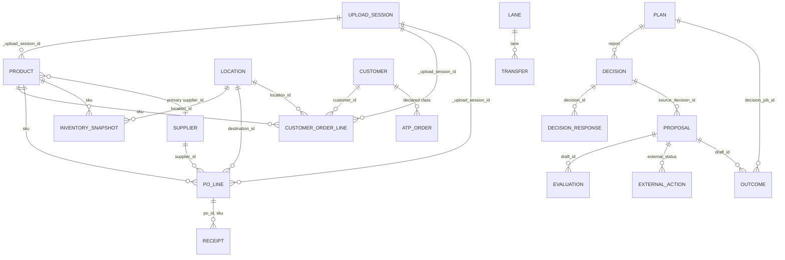

# ZAAD semantic layer — architecture (companion to `ENTERPRISE_ANALYTICS_ARCHITECTURE.md`)

Architecture only (2026-09-16). Nothing here is implemented; the metric contracts below are the
target shape, and every metric is classified against what the repository holds today.

The semantic layer is the one place where a business definition lives. Insights, Explore, Ask
ZAAD, exports, the optimizer's workspace adapter and the value registers all read definitions
from it; none of them defines a KPI of its own. It sits between the canonical vault tables
(`stg_fmcg_*`, `stg_atp_*`, `stg_po_*`, `zaad_*`, the job store) and every consumer.

## 1. What exists today, read from the code

| today | where | role in the target |
|---|---|---|
| filter vocabulary `Scope` (bucket, start, end, sku, category, brand, customer, location, supplier) | `api/product/insights.py` | becomes the first `AnalyticsQuerySpec.filters` and `time_grain` |
| metric definitions as prose in `provenance(metric=…, numerator=…, denominator=…)` | `insights.py` (one call per chart) | becomes machine-readable `MetricContract` rows; the prose is kept as `business_definition` |
| null reasons `UNKNOWN NOT_MEASURED NOT_APPLICABLE NO_DATA BLOCKED_BY_DATA NOT_IN_PLAN` | `insights.py NULL_REASONS`, `insights.ts REASON_LABEL` | the contract's `null_behavior` vocabulary, plus `INSUFFICIENT_COVERAGE` |
| value registers, never combined | `insights.py VALUE_REGISTERS`, `value()` | five governed measures with `register` as a mandatory dimension |
| "weeks of cover", "service level", "fill", "lateness with coverage" | `catalog.py`, `diagnostics.py`, `insights.py` (three modules, one formula each) | one contract each; the modules become consumers of the contract's SQL fragment |
| the plan's ledger, actions, verdicts | job store `report_json` read verbatim by `latest_plan` / `decisions_of_plan` | `fact_decisions` and the MODELED register, sourced from the plan snapshot, never recomputed |
| coverage counts (lines without shipped qty, orders without promised date, rows without cost) | per chart in `insights.py` | `coverage_definition` per metric |

## 2. Entities

An entity is a canonical thing with an identity, a grain and a source. Entities are logical: the
first implementation maps them onto the existing vault tables as views; physical projections
come only where §7 of the primary document justifies them.

| entity | grain | today's source | identity | status |
|---|---|---|---|---|
| Product | one SKU | `stg_fmcg_skus` (dedup: latest `imported_at`) | `sku` | EXISTS |
| Supplier | one supplier | `stg_fmcg_suppliers` (optional upload) + `supplier_id` on POs | `supplier_id` | EXISTS (master optional; a supplier seen only on POs is "known by id, no master") |
| Customer | one customer | `customer_id` on `stg_fmcg_orders`; `stg_atp_customer_orders` for declared classes | `customer_id` | EXISTS (no customer master today: name, channel from order rows) |
| Location | one site | `stg_fmcg_locations`; `location_id` on inventory / orders / `destination_id` on POs (default `MAIN`) | `location_id` | EXISTS |
| Purchase order / PO line | one `po_id` × `sku` | `stg_fmcg_purchase_orders` | `(po_id, sku)` | EXISTS (a PO header is a grouping of its lines; no separate header table) |
| Receipt | one receipt line | `stg_fmcg_receipts` (`po_id`, `sku`, `qty_received`, `qty_rejected`) | `receipt_id` | EXISTS |
| Inventory snapshot | one `(snapshot_date, sku, location)` | `stg_fmcg_inventory` (latest row per key by `imported_at`) | composite | EXISTS |
| Customer order / line | one `order_id` × `sku` | `stg_fmcg_orders` (`qty_ordered`, `qty_shipped`, `requested_delivery_date`, `channel`) | composite | EXISTS |
| Fulfillment / shipment | what was shipped against a line | `qty_shipped` on the order line (no shipment entity) | — | DERIVABLE from the order line; a shipment entity REQUIRES NEW DATA |
| Transfer | one lane movement | `stg_fmcg_transfers` | transfer id | EXISTS (network workspaces) |
| Route / lane | one origin → destination lane | `stg_fmcg_lanes`; supplier corridors on `stg_fmcg_suppliers` (`015_supplier_origin`) | lane id | EXISTS |
| Sector / physics | per SKU | sector columns on `stg_fmcg_skus` (`017`) | — | EXISTS where declared |
| Plan | one completed job | job store (`purpose = WORKSPACE_PLAN`, `report_json`, `request_json`, `information_hash`, `as_of`) | `job_id` | EXISTS |
| Decision | one verdict / action inside a plan | plan `commitments.orders`, `actions` (as `decisions_of_plan` flattens them) | `(job_id, decision_id)` | DERIVABLE from the plan snapshot (not stored as rows today) |
| Decision response | what a person did with a decision | `zaad_decision_responses` (status, reason_code, information_hash) | `response_id` | EXISTS |
| Proposal | a proposed order (draft) | `zaad_draft_orders` / `zaad_draft_lines` / `zaad_draft_events` (origin, state, revision, supersedes) | `draft_id` | EXISTS |
| Evaluation | a proposal's two-run comparison | `zaad_evaluations` (baseline / proposal job ids, workspace_version, draft_hash) | `evaluation_id` | EXISTS |
| Approval | the approving event | `zaad_draft_orders.approved_by/approved_at`, `zaad_draft_events`, `zaad_audit_log` | event | EXISTS |
| External action | placement recorded by a person | `zaad_draft_orders.external_status/reference/updated_at`; export log `zaad_export_log` | draft + event | EXISTS |
| Outcome | an observed result after an action | `zaad_outcomes` (metric, value, unit, observed_at, source, comparator_value, comparator_basis) | `outcome_id` | EXISTS |
| Upload session / dataset version | one upload of one file | `_upload_session_id`, `_uploaded_at`, `_source_file` on every staging table; `intake` status | session id | EXISTS (per-row stamps; no dataset-version object yet — §8 of the primary) |
| Business unit | a scoping dimension | none | — | REQUIRES NEW DATA (`business_unit_id` on master rows or a location → BU map) |

## 3. Dimensions

| dimension | source column(s) | hierarchy | status |
|---|---|---|---|
| SKU, product name | `stg_fmcg_skus.sku`, `sku_name` | SKU → sub-category → category | EXISTS |
| Category / sub-category / brand | `category`, `sub_category`, `brand` | as above | EXISTS |
| ABC class | `abc_class` | flat | EXISTS where uploaded |
| Supplier | `supplier_id` (+ name from master) | supplier → origin country / corridor | EXISTS; origin EXISTS where the supplier master carries it |
| Customer, channel | `customer_id`, `channel` | customer → channel | EXISTS |
| Service class | `stg_atp_service_classes` / `stg_atp_customer_orders.service_class` | flat | EXISTS where declared |
| Location, location kind | `location_id`, `stg_fmcg_locations.kind` | site → kind | EXISTS |
| Destination (PO), ship-from (ATP) | `destination_id`, `ship_from` | — | EXISTS |
| Lane / corridor | `stg_fmcg_lanes`, supplier corridor | origin → destination | EXISTS where declared |
| Date → day / week / month / quarter / year | every date column; ISO weeks; `date_trunc` | calendar hierarchy | EXISTS (day/week/month today; quarter/year DERIVABLE) |
| Fiscal calendar | none | — | FUTURE (owner: whether fiscal periods are needed) |
| PO state (open / received / late), order state | arithmetic in `catalog.purchase_order_page` | flat | DERIVABLE (governed definition) |
| Decision verb (KEEP DEFER EXPEDITE REDUCE CANCEL SPLIT BUY MOVE) | plan snapshot | flat | EXISTS |
| Response status (approved / rejected / overridden …) | `zaad_decision_responses.status` | flat | EXISTS |
| Proposal origin / state | `zaad_draft_orders.origin`, `state` | flat | EXISTS |
| Value register | code constant | flat | EXISTS |
| Sector | `stg_fmcg_skus` sector columns | flat | EXISTS where declared |
| Business unit, region | none | — | REQUIRES NEW DATA |
| Actor / role | `zaad_audit_log.actor`, registry actors | — | EXISTS (governance dimension; restricted) |

## 4. Measures — the governed catalogue, classified

Classification: **EXISTS** (computed today by a released module with that exact meaning),
**DERIVABLE** (computable from today's canonical rows under a contract to be written),
**REQUIRES NEW DATA** (needs a column or entity the vault does not hold), **FUTURE** (depends on
an unreleased engine phase or on customer validation).

| metric_id | definition (business) | numerator / denominator | today | status |
|---|---|---|---|---|
| `ordered_units` | units on customer order lines | Σ `qty_ordered` / — | `insights.demand` | EXISTS |
| `ordered_lines` | customer order lines | count / — | `insights.demand` | EXISTS |
| `shipped_units` | units shipped on lines that record a shipped quantity | Σ `qty_shipped` where not null / — | `insights.demand`, `service` | EXISTS |
| `unfulfilled_units` | ordered − shipped on measured lines | Σ (`qty_ordered` − `qty_shipped`) where shipped not null | same | EXISTS (lines without shipped qty are NOT_MEASURED, never lost) |
| `fill_rate` (customer) | shipped ÷ ordered on measured lines | `shipped_units` / `ordered_units` (measured lines) | `insights.service` "service level" | EXISTS |
| `supplier_fill_rate` | received ÷ ordered on matched POs | Σ `qty_received` / Σ `qty_ordered` over POs with ≥ 1 receipt | `diagnostics`, `insights.suppliers` | EXISTS |
| `short_fill_rate` | matched POs received below tolerance | count short / matched POs | `diagnostics` (`SHORT_FILL_TOLERANCE`) | EXISTS |
| `lead_time_p50`, `lead_time_p90` | days PO date → first receipt | quantiles over matched POs | `diagnostics`, `insights.suppliers` | EXISTS |
| `lead_time_variability` | spread of lead time (p90 − p50, or IQR) | — | none as a named metric | DERIVABLE |
| `late_order_rate` | POs received after their promised date ÷ POs that carry a promised date | count late / count with promised date (coverage = share carrying a date) | `insights.suppliers`, `diagnostics.lateness_account` | EXISTS |
| `open_po_units`, `open_po_value` | units / value still owed on open POs | Σ (`qty_ordered` − received) × `unit_cost` | `catalog._open_po_cte`, `insights.supply` | EXISTS (value NOT_MEASURED where `unit_cost` is null) |
| `open_po_aging` | open units by age bucket of the promised date | bucketed | `insights.supply` | EXISTS |
| `inventory_units`, `in_transit_units` | latest snapshot per SKU × site | Σ `on_hand`, Σ `in_transit` | `catalog._stock_cte`, `insights.inventory` | EXISTS |
| `inventory_value` | on hand × unit cost | Σ `on_hand` × `unit_cost` (NOT_MEASURED where cost missing) | `catalog`, `insights.inventory` | EXISTS |
| `weeks_of_cover` | on hand ÷ average weekly ordered units over the trailing 12 weeks | `inventory_units` / (`ordered_units` 12 w ÷ 12) | `catalog._demand_cte`, Inventory page, `insights` | EXISTS (one definition today; the contract pins it) |
| `excess_inventory` | units above a stated cover threshold (e.g. > 12 weeks) | `inventory_units` − threshold × weekly demand, floored at 0 | Inventory cover buckets (`over12`) | DERIVABLE (threshold is a contract parameter, never a hidden constant) |
| `shortage_exposure` | units short of a stated cover threshold, or the plan's modeled unmet | two distinct metrics: `cover_shortfall` (DERIVABLE) and `modeled_unmet` (plan `service_reliability`, EXISTS in plan) | Inventory `under2`; plan | DERIVABLE / EXISTS-in-plan |
| `customer_concentration` (top-1 share, top-5 share, HHI) | shares of ordered units | — | `insights.demand` | EXISTS |
| `demand_change_pop` | period-over-period change on complete buckets | — | `insights.demand` (`partial_last_period` flag) | EXISTS |
| `decisions_by_verb` | count of plan decisions per verb | count / — | `insights.decisions` | EXISTS |
| `decision_response_counts` | recommended / approved / rejected / overridden / externally executed / outcome available — six counts, not a funnel | counts | `insights.decisions` | EXISTS |
| `modeled_difference` | plan ledger: incumbent total − selected total | plan `economics` | `insights.value` | EXISTS (register MODELED_DIFFERENCE) |
| `backtested_opportunity` | held-out replay difference | — | not wired | FUTURE (needs the replay harness on customer history) |
| `approved_expected_difference` | an approved proposal's evaluation difference | `evaluation.compare` | `insights.value` | EXISTS |
| `observed_after_action` | outcomes recorded after an action, by metric | `zaad_outcomes` | `insights.value` | EXISTS (not attributed) |
| `realized_value` | outcomes with a comparator and its stated basis | `zaad_outcomes` where comparator present | `insights.value`, `zaad_history.realized_value` | EXISTS |
| `override_rate` | responses overridden ÷ responses | — | DERIVABLE from `zaad_decision_responses` | DERIVABLE |
| `forecast_accuracy` | fitted vs observed | — | fits live in the request build only | FUTURE (P6) |
| `otif` (line-level on time in full) | lines shipped in full by requested date | needs shipment date per line | `requested_delivery_date` exists; ship date does not | REQUIRES NEW DATA |
| `landed_cost`, `freight` | — | — | supplier terms partially declared | FUTURE (P7/P8) |
| `capital_tied` (working capital) | plan `selected_working_capital` | plan | plan economics | EXISTS-in-plan |

Rules the catalogue enforces:

* **No metric without a denominator statement.** Ratios carry numerator, denominator and the
  coverage of the denominator (`late_order_rate` states how many orders carry a promised date).
* **No silent constants.** Thresholds (cover buckets, short-fill tolerance, thin-sample size) are
  named contract parameters with their released values (`SHORT_FILL_TOLERANCE`, `THIN_SAMPLE`).
* **Register is a dimension, never summed across.** The five value measures are separate
  `metric_id`s; a query that requests two registers returns two series, and the visual layer
  refuses a stacked or summed rendering of them.
* **Plan-sourced measures are snapshots.** They carry `plan_id`, `as_of`, `information_hash` and
  `stale`, are read from the stored report, and are never recomputed by the analytics engine.

## 5. Metric contract

```yaml
# example: the contract every metric carries (documentation shape, not runtime code)
metric_id: late_order_rate
version: 1
display_name: { en: "Late-order rate", ar: "نسبة أوامر الشراء المتأخرة" }
description: { en: "Share of received purchase orders that arrived after their promised date." }
business_definition: >
  Among purchase orders that carry a promised (expected delivery) date and have at least one
  receipt, the share whose first receipt date is after the promised date.
numerator: { entity: purchase_order, expr: "count(po) where first_receipt_date > expected_delivery_date" }
denominator: { entity: purchase_order, expr: "count(po) where expected_delivery_date is not null and matched" }
source_entities: [purchase_order, receipt]
time_semantics: { anchor: first_receipt_date, grains: [week, month, quarter], window: "as filtered" }
aggregation_rule: ratio_of_sums            # never average of ratios
allowed_dimensions: [supplier, sku, category, brand, destination, corridor, date]
disallowed_dimensions: [customer]          # a PO has no customer
required_fields: [po_date, expected_delivery_date, receipt_date]
coverage_definition:
  measure: "share of matched POs carrying a promised date"
  insufficient_below: 0.5                  # below this, INSUFFICIENT_COVERAGE, value still shown with the flag
  thin_sample_below: 8                     # THIN_SAMPLE today
null_behavior:
  no_matched_orders: NO_DATA
  no_promised_dates: BLOCKED_BY_DATA
  zero_late_with_full_coverage: 0          # zero is a count
unit: ratio
currency_behavior: none
grain: purchase_order
owner: "ZAAD product (supplier diagnostics)"
evidence_class: OBSERVED_FACT             # vs ASSOCIATION, MODELED, PLAN_SNAPSHOT
security_classification: OPERATIONAL      # OPERATIONAL | ECONOMIC | GOVERNANCE | RESTRICTED
implementation: { engine: duckdb, fragment_ref: "metrics/late_order_rate.sql" }
lineage: [stg_fmcg_purchase_orders, stg_fmcg_receipts, diagnostics._matched_cte]
compat: { since: "2026-10", deprecates: null }
```

A second shape for a plan-sourced measure:

```yaml
metric_id: modeled_difference
register: MODELED_DIFFERENCE               # mandatory; never combined with another register
source_entities: [plan]
aggregation_rule: snapshot                 # read verbatim from the plan's economics block
allowed_dimensions: [plan, sku, supplier, decision_verb]
null_behavior: { no_completed_plan: NOT_IN_PLAN, plan_without_economics: NOT_IN_PLAN }
freshness: { carries: [plan_id, as_of, finished_at, information_hash, stale] }
evidence_class: MODELED
security_classification: ECONOMIC
```

What the contract forbids: an AI-generated definition (Ask ZAAD may only *reference*
`metric_id`s), a frontend-generated definition (the web never computes a KPI — it formats what the
server sent, the rule V2.1A already keeps), a dashboard-specific formula (a saved visual references
a `metric_id@version`, nothing else), and two dashboards disagreeing (there is one contract per
id and version).

## 6. Relationships (the semantic graph)



Joins the layer allows are exactly these edges; a query spec that combines entities without a
path (customer × supplier without a product bridge) is refused with `semantic_no_join_path`, not
guessed. Many-to-many paths (product ↔ supplier through PO lines when alternates exist) are
declared with their bridge so that a measure is never fanned out twice.

## 7. Valid filters and aggregations

* A filter is valid only on a dimension the metric allows; the validator returns the allowed set.
* Aggregation is fixed per metric (`sum`, `count`, `ratio_of_sums`, `quantile`, `latest_snapshot`,
  `snapshot`); the requester chooses grain and dimensions, never the aggregation function.
* `latest_snapshot` measures (inventory) are non-additive over time: a month bucket is the last
  snapshot in the month (today's rule), never a sum of snapshots; the validator refuses
  `sum` over a snapshot metric.
* Ratios are recomputed from their sums at the requested grain; no average of averages.
* Currency: money measures carry the workspace currency (`stg_fmcg_economics` / request
  `currency`); multi-currency is REQUIRES NEW DATA and refused until declared.

## 8. Coverage and null semantics (the honesty rule, formalised)

Every result cell is `{value, reason?, coverage?}`. Reasons: `UNKNOWN`, `NOT_MEASURED`,
`NOT_APPLICABLE`, `NO_DATA`, `BLOCKED_BY_DATA`, `NOT_IN_PLAN`, `INSUFFICIENT_COVERAGE`. A `0` is a
count of rows that exist. The contract decides which reason each missing case maps to; the query
engine never substitutes a default. Renderers (§12 of the primary) receive the reason and must
break the line, not draw zero. Ask ZAAD receives the reason and must state it as missing data.

## 9. Lineage and versioning

* `metric_id` is immutable and language-independent; `display_name` is localised.
* A change of definition is a new `version`; the old version stays resolvable for saved objects
  that pin it, with a deprecation date. A saved visual is stored with `metric_id@version` and
  `semantic_model_version`; opening it after a deprecation shows the pinned definition with a
  "newer definition available" note — it never silently changes.
* Lineage per metric: source tables → CTE / fragment → metric → query id → visual → answer →
  decision → outcome (§24 of the primary), inspectable from "Data & scope".

## 10. Permissions on the layer

Each metric and dimension carries a `security_classification`; roles (§18 of the primary) map
to classifications (Viewer: OPERATIONAL; Executive: OPERATIONAL + ECONOMIC; Auditor: +
GOVERNANCE; Admin: all). Row-level scopes (business unit, region, warehouse) are dimension
predicates attached to the actor and appended by the query planner, never by the caller.

## 11. Ownership

Definitions are owned by ZAAD product and versioned in the repository (`analytics/semantic/`
catalogue files reviewed like code). Whether a customer may add calculated metrics of their own
is an owner decision (primary document §57); the architecture supports it only as a separate,
lower-trust class (`CUSTOMER_DEFINED`, never blended with governed metrics in the same visual
without a label).
